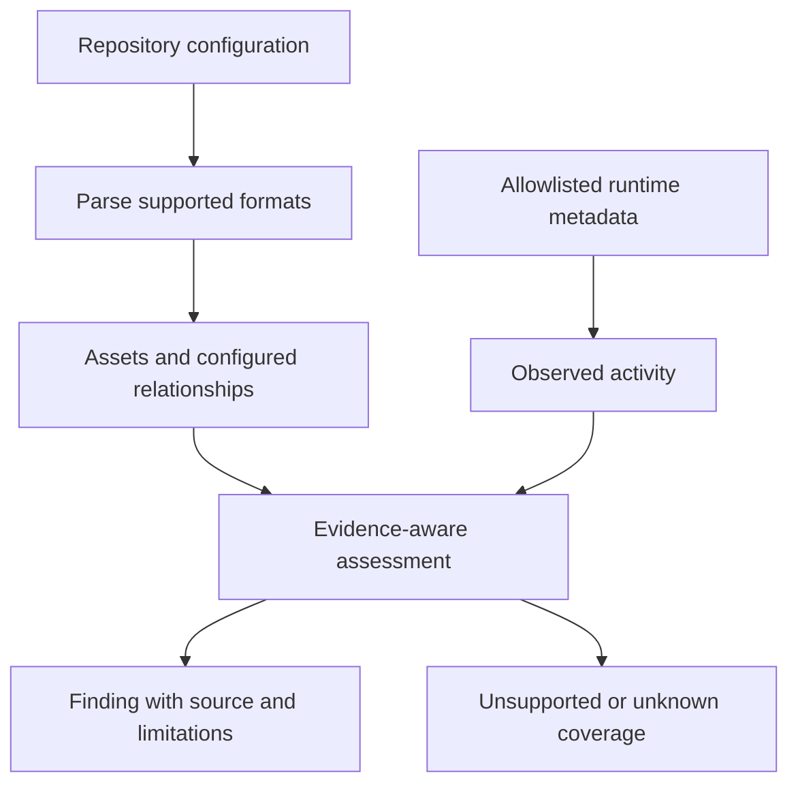
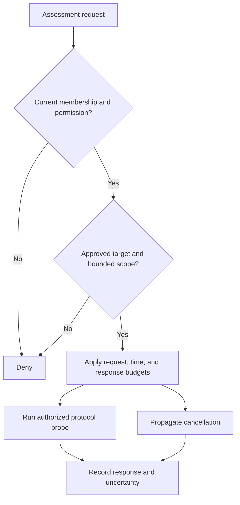
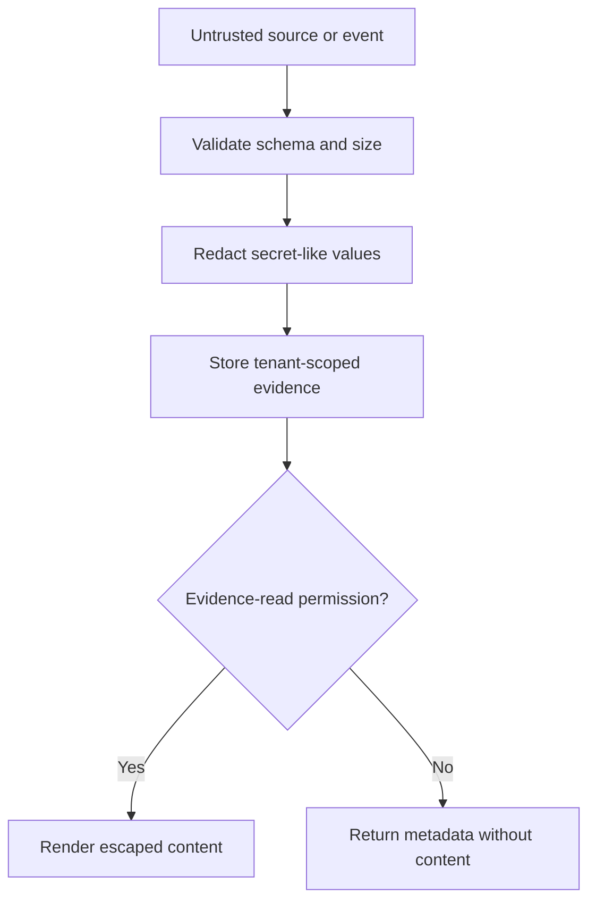

# Evidence-Driven AI Agent and MCP Security

An agent security assessment should explain what an agent can reach, which authority
it receives, and what evidence supports each conclusion. Counting discovered tools
or drawing an impressive relationship graph does not answer those questions.

These findings synthesize source-level research into repository discovery, agent
settings, CI workflows, remote MCP assessment, and runtime metadata. They are
**engineering findings and recommendations**, not a claim of production compromise,
complete prompt-injection coverage, or tests reproduced in this article. The diagrams
are illustrative. See the [authorization lab](../labs/ai-agent-security/README.md)
for the separate, bounded controls exercised by this repository.

## Decision: keep evidence states separate

Configuration, effective permission, observed activity, and inference should remain
separate facts. A workflow granting write access is configured authority. A recorded
tool call is observed activity. Neither proves that an attack succeeded.

Attach source revision, file location, rule version, evidence state, and limitations
to every finding. Preserve conflicting observations rather than silently overwriting
a configured edge with an observed edge. A static reference to an external endpoint
can establish a configured destination; it does not establish that traffic reached it.

For protocols, use the [MCP specification](https://modelcontextprotocol.io/specification)
as the primary reference and identify the exact revision during review. A tool
server's advertised interface does not establish that its implementation, operator,
or returned content is trustworthy.

## Findings from configuration and workflow analysis

The reviewed detection approach focuses on explicit, inspectable authority:

| Evidence | Security implication | Qualification |
| --- | --- | --- |
| Package launched without an exact version or image digest | Future launches may execute changed code | A pin does not prove artifact integrity or benign behavior |
| Literal credential in tool environment, headers, or arguments | Secret may be exposed through repository access or diagnostics | Detection and redaction can miss unknown formats |
| Non-loopback HTTP tool endpoint | Transport lacks TLS protection | A loopback exception is not a remote security boundary |
| Broad filesystem root or host mount | Tool can potentially reach unrelated material | Effective access still depends on identity and runtime policy |
| Privileged container, host namespace, or daemon socket | Tool execution may cross the intended isolation boundary | Container presence alone is insufficient isolation evidence |
| Unrestricted shell or disabled approval prompts | Untrusted planning can acquire broad execution authority | Restricting a prompt does not replace deterministic authorization |
| Comment-triggered CI agent with write permissions | Attacker-controlled text can reach a privileged automation path | Actor checks must cover the actual event and identity model |

Treat these as reviewable risk conditions. A configuration detector must not describe
an unexecuted prompt injection as a reproduced exploit. The [GitHub Actions security
reference](https://docs.github.com/en/actions/reference/security/secure-use) explains
why workflow permissions, untrusted inputs, and dependency pinning require explicit
review at the automation boundary.

## Bound active assessment independently

Passive discovery reads approved sources. Active probing sends requests to a system
and needs its own authorization. An authenticated dashboard session is insufficient
permission to probe every URL present in a repository.

For a remote MCP authentication check, an unauthenticated protocol response is
bounded evidence about that endpoint and request. An accepted initialization does
not prove arbitrary tool execution, cross-tenant access, or authentication bypass on
every method. Redirect targets, DNS changes, internal address ranges, response sizes,
and cancellation need independent controls before enabling server-side requests.
This article does not claim those protections are fully implemented in the reviewed
code or verified against a live service.

## Minimize evidence before it becomes durable

Redact credentials before storage, not just in the browser. Keep restricted evidence
behind its own read permission. A user who can see a finding title may not be entitled
to see the underlying document or transcript.

Runtime telemetry should use an explicit allowlist, bounded field lengths, and clear
retention policy. Model names, tool names, endpoints, and timestamps can still reveal
sensitive operational information even when prompt and response bodies are absent.
The [OpenTelemetry GenAI conventions](https://opentelemetry.io/docs/specs/semconv/gen-ai/)
are a vocabulary reference, not permission to collect every available attribute.

A new-destination signal is an inference for investigation. Legitimate rollout can
produce the same pattern, and missing telemetry can conceal actual activity. Keep
severity, evidence confidence, and coverage distinct in both exports and charts.

## Validation and limitations

A useful validation matrix includes malformed configuration, unknown launchers,
mutable action references, plaintext secrets, denied evidence access, cross-tenant
identifiers, cancelled jobs, missing telemetry, and active probes without scope.
Test successful and denied paths using synthetic inputs and authorized endpoints.

Source review establishes how a design is expressed; it does not reproduce a remote
assessment, validate an identity-provider deployment, or establish production safety.
Configuration formats evolve, secret redaction is incomplete, and absence of a
finding is meaningful only within the declared parser and rule coverage. Full source
review and protocol-version confirmation remain required before promoting this
article's review status.

## References

- [MCP specification](https://modelcontextprotocol.io/specification)
- [GitHub Actions secure use reference](https://docs.github.com/en/actions/reference/security/secure-use)
- [OpenTelemetry GenAI semantic conventions](https://opentelemetry.io/docs/specs/semconv/gen-ai/)
- [Local AI-agent authorization lab](../labs/ai-agent-security/README.md)
