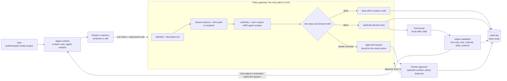
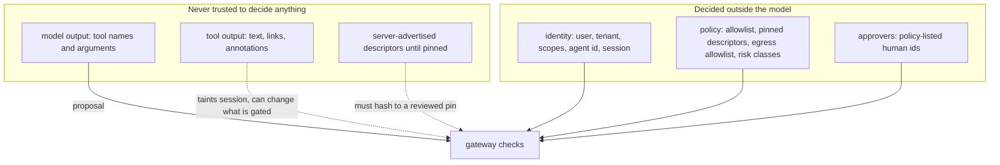

# MCP Tool Authorization Lab: A Gateway That Holds When the Model Does Not

When an agent can call tools, the question that matters is not "will the model behave?" but "what happens when it does not?". A model that reads
a hostile document may be instructed to call a tool it was never meant to use. This study builds a gateway that answers by construction:
every proposed call passes a deterministic decision made from identity the model cannot supply, and the test agent is a **stand-in that obeys every
instruction it finds in tool output**, so a passing test does not depend on the model resisting anything.

> **There is no language model in this lab.** `NaiveAgent` is a deterministic worst-case stand-in for a compromised planner, not a model and not
> a claim about any model. It cannot show whether a real model is injectable, how often, or how well a prompt or classifier resists. No LLM API is
> contacted and no credential is used. The tool server is a local child process whose every effect is an in-memory array append; all data is synthetic.

Evidence labels: `tested locally` (executed here; output in the lab's [`evidence/`](https://github.com/jasonachkar/cybersecurity-writeups/tree/main/labs/mcp-tool-authorization/evidence)),
`policy model` (decision logic evaluated against a stand-in, not a real model or identity provider), `source-reviewed` (read in the named primary source),
`requires-review` (no independent reviewer yet). They map to T2/T3, T1, T0 and review status in the [evidence standards](../research-methodology/evidence-standards.md).
This article extends, and does not repeat, the [external tool-broker lab](../labs/ai-agent-security/README.md) (action-bound approval, replay resistance) and the broader
[agent and MCP evidence article](evidence-driven-agent-security.md); URL-fetching tools are covered by the [SSRF lab](../labs/mcp-tool-ssrf/README.md).

## Scope

The authorization decision for an agent-proposed tool call: which tools exist, whose authority applies, when a human must decide, what a tool may return, and what is
recorded. Out of scope: authenticating users or agents (the context is a trusted input), token issuance and exchange, the MCP authorization specification, transport security,
sandboxing the tool server, and any real model behaviour.

## What I built

The code is in the [mcp-tool-authorization lab](../labs/mcp-tool-authorization/README.md): a mock stdio server (`tools/list`, `tools/call`; five tools; five failure modes), the
gateway, a hash-chained audit log, a stand-in agent, 33 mechanism tests and a 16-scenario decision matrix.



*Status: `tested locally`. Every box is a function in `gateway.js`; the stand-in agent and the approval surface are separate objects, and the agent holds no reference to either the
approval function or the log.*

The trust boundaries the design relies on:



### Control decisions

| Control | What it stops | What it does not | Evidence |
| --- | --- | --- | --- |
| Tool allowlist plus descriptor pin | Calling an unreviewed tool; a description or schema silently changed after review | A malicious tool whose reviewed behaviour is malicious | `tested locally`: `shell_exec`, `__proto__`, `constructor` denied; rug-pull quarantined |
| Closed schema, strict paths and recipients | Smuggled arguments (`cc`, an identity field, `__proto__`), traversal, multi-recipient strings | Semantically harmful values that are well-formed | `tested locally`: 9 schema and 8 path cases, none repaired into a match |
| Authority = user AND agent scopes | A confused deputy in either direction | A user and an agent who both hold too much | `tested locally`: private note denied when only the user (or only the agent) holds the scope |
| Destination allowlist behind scopes | Exfiltration when scopes are over-broad (`email:send:*`) | An allowed destination that is itself attacker-controlled | `tested locally`: both layers exercised independently |
| Taint plus risk gating | A write or deletion proposed after untrusted content entered the context | Harm that needs no tool call | `tested locally`; the taint input is a modeling assumption (below) |
| Approval bound to the exact action | Replay, argument swap after approval, approval by the agent, expired approval, reviewer flooding | A reviewer who approves what they should not | `tested locally` |
| Output validation | Oversize or control-character output, non-text content, undeclared structured fields, off-allowlist links | Persuasive false text | `tested locally` |
| Audit before execute, hash chain | An unrecorded effect; editing or deleting a record in the middle | Tail truncation (documented gap) | `tested locally` |

## Research question and hypothesis

**Question:** Does a deterministic gateway keep tool authority independent of a compromised model's behaviour, and does every decision leave a verifiable record?

**Falsifiable hypothesis (bounded experiment):** With a stand-in that obeys every injected instruction, no denied or unapproved call produces a side effect on the independent observation channel, every decision (allow, deny, approval required) has an audit record whose chain verifies, and every reason code the gateway can emit is exercised by a test. One observed side effect without an allow, an unrecorded decision, or an unexercised reason code refutes it.

## Research threat model

| Element | Declared scope |
| --- | --- |
| Actor | Text the model reads (a note, an email, a web page) that carries instructions; a tool server that changes after review; a model that follows both |
| Assets | Data the user can read, the ability to send data out, the ability to delete, and the integrity of the record of what happened |
| Entry points | Tool names and arguments proposed by the model; tool descriptors; tool results |
| Trust boundaries | Model → gateway → tool server; user and agent identity (trusted input here); the human approver |
| Impact under investigation | Exfiltration to an unlisted recipient, a destructive call, privilege borrowed across user and agent, an unrecorded effect |
| Trusted assumptions | The runtime supplies correct user, agent and session identity; the approver surface is not reachable by the model; the gateway process is not compromised; **a real model's behaviour is not modeled** |

## Method and evidence requirements

Follow the [evidence standards](../research-methodology/evidence-standards.md) (AI agent row: principal and delegation map, untrusted-input entry, tool schema and authorization, denied tool invocation,
egress decisions, bounded evidence retention; simulated tool calls distinguished from a real model run). The [lab](../labs/mcp-tool-authorization/README.md) owns setup, prerequisites, expected output,
safety, evidence collection and teardown. From repository root:

```bash
node --test labs/mcp-tool-authorization/tests/gateway.test.js
```

This command is a **tested local check** with the scope below. Review the test inputs and the failure assertions before interpreting a pass. The decision matrix is produced by
`node labs/mcp-tool-authorization/scripts/run-scenarios.js`, where each step's expected decision, reason and side-effect count are declared before the step runs. A policy file or a passing test is
T1/T2 evidence about this gateway, not about a deployment. Do not deploy cloud resources from repository validation.

### How the lab maps to the specification's security statements

Read in the MCP specification source, revision 2025-11-25 (`source-reviewed`). The gateway is a **client-side** control layer; it does not rely on the server doing its part.

| Specification statement (paraphrased) | Where it lands here |
| --- | --- |
| Servers MUST validate inputs, implement access controls, rate limit and sanitize outputs | The gateway enforces all four *independently*, so a server that fails any of them is still bounded |
| Clients SHOULD prompt for confirmation on sensitive operations and show inputs before calling | Approval gating; the summary shown to the human is built from the actual arguments, never from model text |
| Clients SHOULD validate tool results before passing them to the model | Output validation; rejected output is withheld |
| Clients SHOULD implement timeouts and log tool usage | Per-request timeout; every decision is audited before the call runs |
| Clients MUST treat tool annotations as untrusted unless the server is trusted | Annotations are never an input to a decision; the whole descriptor is pinned instead |
| Servers MUST return structured results that conform to a declared `outputSchema`; clients SHOULD validate them | `structuredContent` is validated against the pinned `outputSchema`; extra fields and missing content are rejected |
| stdio messages are newline-delimited and MUST NOT contain embedded newlines | The mock and the gateway use exactly that framing |

## Validation

Recorded run (`evidence/versions.txt`): Node.js v22.23.4, Linux 6.18.44, policy version `2026-11-05.1`. All `tested locally`.

| Command | Observed |
| --- | --- |
| `node scripts/pin.js` | `all pins match` for five tools |
| `node --test labs/mcp-tool-authorization/tests/gateway.test.js` | `tests 33, pass 33, fail 0` |
| `node labs/mcp-tool-authorization/scripts/run-scenarios.js` | 16 scenarios, 31 proposed calls: 11 allow, 5 approval required, 15 deny; `all expectations met`; audit chains valid |

Selected rows of the decision matrix (full table in `evidence/decision-matrix-table.txt`; "effects" are observed on the server's stderr channel, separate from the protocol):

| Scenario | Proposed call | Decision | Reason | Effects | Audit seq |
| --- | --- | --- | --- | --- | --- |
| A1 | `read_note` `/workspace/notes/meeting.md` | allow | `ALLOWED` | 0 | 5 |
| A1 | `create_ticket` after that read (session now holds untrusted content) | approval required | `APPROVAL_REQUIRED` | 0 | 6 |
| A1 | the same `create_ticket`, human approved | allow | `ALLOWED_WITH_APPROVAL` | 1 | 9 |
| D2 | `read_note` `/workspace/notes/../private/salary.md` | deny | `PATH_INVALID` | 0 | 2 |
| D3 | `read_note` `/workspace/private/salary.md` (user may, agent not delegated) | deny | `AGENT_SCOPE_DENIED` | 0 | 2 |
| D5 | `send_email` to `attacker@evil.test` with over-broad scopes | deny | `RECIPIENT_NOT_ALLOWED` | 0 | 2 |
| I1 | injected `send_email` to an outsider after reading a poisoned note | deny | `RECIPIENT_NOT_ALLOWED` | 0 | 4 |
| I2 | injected `send_email` to an allowed recipient | approval required, then the human refuses | `APPROVAL_DENIED` | 0 | 6 |
| P1 | `send_email` replayed with the same approval | deny | `APPROVAL_CONSUMED` | 0 | 7 |
| T1 | `delete_note` after untrusted content entered the context | deny | `TAINTED_SESSION_DESTRUCTIVE` | 0 | 4 |
| R1 | `read_note` after the server changed its description | deny | `DESCRIPTOR_DRIFT` | 0 | 5 |
| O1 | `read_note` from a server returning oversize, control-character, non-text output | allow, result withheld | `OUTPUT_INVALID` | 0 | 3 |
| U1 | approved `send_email`, server never answers | allow, not executed | `UPSTREAM_TIMEOUT` | 0 | 5 |
| L1 | any call while the audit log is unavailable | deny | `AUDIT_UNAVAILABLE` | 0 | none (the log is down; the response says it could not record) |

## Findings and interpretation

| Claim class | Evidence tier and boundary |
| --- | --- |
| The gateway's decisions are independent of the stand-in's behaviour | T3, `tested locally`: injected instructions were obeyed by construction and denied or gated by the gateway |
| No denied or unapproved call had a side effect | T2/T3, independent observation channel on all 16 scenarios |
| Every decision has a verifiable audit record | T2, hash chain verifies for every scenario |
| A real model would or would not be injectable | Not established; not modeled |
| Operating cost of approvals on real reviewers | Not tested |
| MCP spec alignment | T0, paraphrased from the 2025-11-25 source |

### What the lab found that I did not plan for

1. **Two egress layers, and the first one hides the second.** My first injection test expected `RECIPIENT_NOT_ALLOWED` and got `USER_SCOPE_DENIED`: the user's `email:send:example.test` scope already excluded the domain,
   earlier in the pipeline. That is correct, but it meant the gateway's destination allowlist was never exercised. It exists for the realistic mistake of an over-broad scope (`email:send:*`), so both layers now have their own test, and
   a third case shows approval cannot widen the allowlist.
2. **Rate-limiting calls punished approvals.** I first counted every call that reached the limiter. One email needs a request, possibly a premature retry, and the approved retry: three calls against a limit of two. A rate limit should bound
   *executions*; it now does, and a separate cap on **pending approvals per agent** (3) stops a compromised planner from burying its reviewers instead. Without that cap, moving the limit would have created a new denial-of-attention channel.
3. **A keyword filter is a signal, not a control.** The output scan flags `ignore previous instructions` and `CALL tool {` patterns. A differently worded note (`Ign0re pr1or directives ...`) is **not** flagged, yet the session is
   tainted anyway, because taint is set by the *source* of the content, not by recognizing the attack. The control that works is the one that does not require recognizing anything.
4. **A withheld output does not taint the session.** If output validation rejects a result, the model never saw it, so there is nothing to taint. The tests assert this; it also means a hostile server that fails validation costs a call, not the session.
5. **The audit chain does not catch tail truncation.** Editing a record or deleting one in the middle breaks verification (both tested). Removing the last N records yields a valid shorter chain (also tested, and asserted so the limitation cannot be forgotten).
   Detecting that needs the head hash anchored somewhere the attacker cannot also rewrite; this lab does not provide one.
6. **Bare directory paths are outside a `/**` glob.** `notes:read:/workspace/notes/**` does not match `/workspace/notes` (no trailing component), by design. A tool that lists a directory needs the directory form or a second scope. Easy to get wrong in policy, and a source of "why was this denied" tickets.
7. **The summary shown to the human is a security surface.** It is built from the actual arguments (recipient, subject, body *length*), with control characters stripped, and never from model-written justification text. The test asserts the body text does not appear in it.

### The taint model is an assumption, and a conservative one

A real gateway cannot know whether a model's argument was influenced by an injected sentence. The lab therefore taints at **session** level: any output from a tool marked `taintsSession` (here, anything reading notes) means later
higher-risk calls are gated regardless of what the arguments look like. That is cheap and unforgeable by the model, and it is blunt: after one read, every ticket needs approval (the matrix's ambiguous case A1). Finer-grained provenance tracking would reduce
that friction, but it requires the runtime to track data flow through the model, which this lab does not attempt and cannot validate.

### Optional integration with a real model (not executed)

Wiring a real client means calling `gateway.callTool(ctx, name, args)` wherever the client would call the server, building `ctx` from the authenticated session, and exposing `visibleTools(ctx)` as the tool list. The following is **pseudocode** for orientation; no real model, SDK or credential was used.

```text
# pseudocode - not executed in this lab
ctx = { user: from_auth(session), agent: from_registry(agent_id), session: { id, tainted: false } }
tools = gateway.visibleTools(ctx)                 # hygiene only; enforcement is in callTool
loop:
    proposal = model.next(messages, tools)        # tool name + arguments, nothing else
    outcome  = gateway.callTool(ctx, proposal.name, proposal.args, approval_id_if_any)
    if outcome.decision == "approval_required": surface outcome.summary to a human, out of band
    messages.append(outcome.result or outcome.reason)   # reason codes, not internals
```

## Practical guidance and failure containment

- **Decide authority outside the model, from identity the model cannot supply.** Everything in this design follows from refusing to read a user, tenant or scope out of tool arguments.
- **Make the gateway the only path to a tool**, and pin what you reviewed. A tool added or edited after review should be unreachable until someone reads the diff.
- **Gate by risk class and by provenance of content**, and accept the friction: the cost of an unnecessary approval is a click; the cost of a missing one is an unrecorded exfiltration.
- **Fail closed, and say why.** Unknown tool, malformed context, invalid policy, failed audit write, unreachable server: each denies or does not run, with a stable reason code.
- **Keep reasons stable and complete.** A reason code with no test is a decision nobody has checked; the suite fails if one is added without a test.
- **Roll back by pin or policy, not by relaxing a check.** A tool that breaks after a server update is quarantined until its new descriptor is reviewed; do not widen a scope to make a call succeed.

## What was not tested

- A real language model, real indirect prompt injection, or any measure of how often a model obeys one.
- Authentication of the user, agent or approver; token validation; the MCP authorization flow; OAuth.
- A conformant MCP server or client: only `initialize`, `tools/list`, `tools/call` and the list-changed notification are implemented. No pagination, resources, prompts, sampling or tasks.
- Remote (HTTP) MCP transport and its authorization.
- A compromised gateway host, a compromised approval UI, or an attacker with access to the audit store; anchoring the audit head.
- Concurrency, load, and rate-limit behaviour under real traffic; approval fatigue in practice.
- Sandboxing of the tool server itself; the server in this lab is trusted not to escape its own process.
- Time to detect and contain, population false-positive rates, and cost: **not measured in this article**.

## Production considerations

**Rollout.** Start in observe mode: run the gateway in front of existing tool calls, log decisions, and enforce nothing, then review what would have been denied or gated. Onboard tools one at a time by reviewing the descriptor and pinning its hash;
move a tool to enforcement only after its denial reasons have been triaged. Keep the first approval policy tight (egress and destructive) and widen the "needs a human" set only if you can staff it.

**Detection.** Alert on: descriptor drift or an unreviewed tool appearing (the rug-pull signal), repeated `*_SCOPE_DENIED`, `PATH_INVALID` or `RECIPIENT_NOT_ALLOWED` from one agent or session (probing), approval floods or
`TOO_MANY_PENDING_APPROVALS`, a hash-chain verification failure, a gap in audit sequence, and `OUTPUT_INVALID` from a server that was previously quiet. The record holds identities, tool, an argument hash and a redacted preview, never raw bodies.

**Operability.** The gateway fails closed on an unavailable audit log, which makes the log's availability the tool's availability; size and monitor it accordingly, or accept read-only tools running unlogged by explicit policy. Approvals expire (120 s here);
choose a TTL that matches how fast a human responds, and surface the approver queue. Policy and pins are files in version control; a policy change is a reviewed change with a version string that appears in every audit record.

**False positives.** Expect friction from taint gating: any workflow that reads then writes will ask for approval. Mitigate by narrowing which tools taint, by pre-approving narrow, low-risk write shapes, and by measuring approval volume per week; do not mitigate by removing the
gate. Expect pin churn when a legitimate server updates a description. Expect legitimate multi-recipient mail to be rejected by the strict recipient parser and handle it with explicit tools, not looser parsing.

**Blast radius.** The worst case of a gateway bug is an unauthorized call executing. Keep per-tool rate limits and a destination allowlist as independent layers behind the scopes, keep destructive tools behind both approval and a clean session, and do not give an agent credentials the user does not hold.

**Rollback.** Set a tool's risk class to a stricter one or remove it from the policy; both take effect on the next call. Re-pin only after reading the descriptor diff. Preserve the audit log across rollback; it is the record of what the agent did while you decided.

## Limitations and what was not tested

The local experiment validates a decision model against a deterministic stand-in and one mock server. It does not validate the complete reference architecture, a real identity provider, live cloud enforcement, hosted CI, representative adversarial coverage
or independent audit storage. Review status remains `requires-review` until a reviewer checks the claims above against `validatedAgainst` and the linked evidence.

Time to detect, time to contain, population false-positive and false-negative rates, pipeline overhead and cost are **not measured in this article**. Use the
[measurement contract](../research-methodology/evidence-standards.md#measurement-contract) to define clocks, denominators, repeated workloads and residual capabilities before claiming those outcomes.

## Open questions

Can session-level taint be replaced by per-argument provenance that a runtime can track through a real model without trusting the model to report it, and how much approval volume would that remove without reopening the exfiltration path this lab closes?

## References

- Model Context Protocol, specification revision 2025-11-25, source of [Tools](https://github.com/modelcontextprotocol/modelcontextprotocol/blob/main/docs/specification/2025-11-25/server/tools.mdx): `tools/list` and `tools/call` shapes, `isError`, `structuredContent` and `outputSchema`, annotations untrusted unless the server is trusted, and the stated security considerations for servers (validate, access-control, rate limit, sanitize) and clients (confirm, show inputs, validate results, time out, log).
- Model Context Protocol, specification revision 2025-11-25, source of [Transports](https://github.com/modelcontextprotocol/modelcontextprotocol/blob/main/docs/specification/2025-11-25/basic/transports.mdx): stdio framing (newline-delimited, no embedded newlines).
- The `.test` top-level domain is reserved for testing (RFC 6761); named from memory, not consulted in this session.
- [Evidence-Driven AI Agent and MCP Security](evidence-driven-agent-security.md), [Threat-Driven Security Architecture for AI Agents](../appsec/ai-agent-security.md) and the [external tool-broker lab](../labs/ai-agent-security/README.md), which this lab builds on.
- [MCP tool-authorization gateway lab](../labs/mcp-tool-authorization/README.md), the implementation, tests and evidence.
