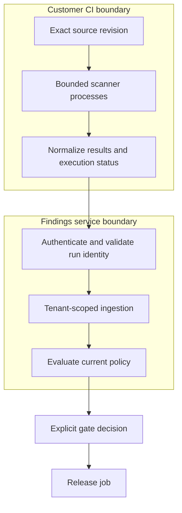
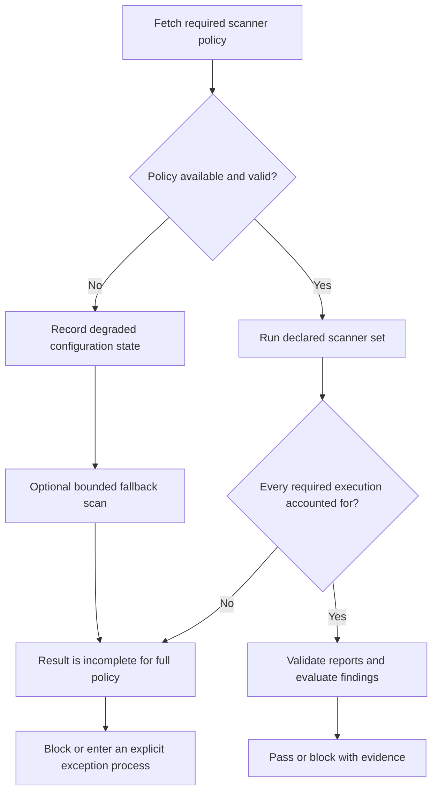
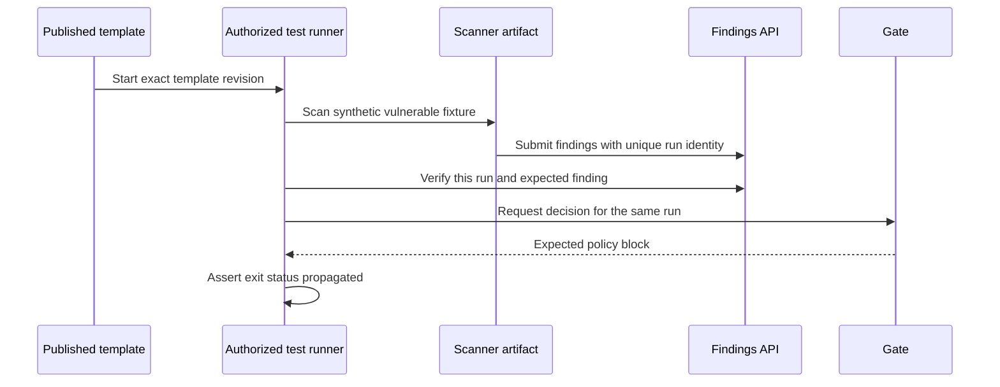

# Evidence-Preserving Security Scanning and Release Gates

Security scanning is a distributed evidence workflow. The process that checks out
source, the process that runs a scanner, the API that accepts findings, and the gate
that authorizes a release each have a separate trust boundary. A dashboard showing
zero findings cannot establish that all intended scanners completed successfully.

This research synthesizes inspected integration code, scanner orchestration, and
release-verification documentation. Recommendations and diagrams are **illustrative**.
No customer pipeline, hosted canary, package publication, or production security
outcome was reproduced for this article.

## Decision: separate execution from findings management

Running scanners inside customer CI keeps checkout and execution in that customer's
runner boundary. A findings service can provide configuration, normalized ingestion,
deduplication, and policy decisions without hosting arbitrary customer source. This
reduces one service-side exposure, but the runner still processes untrusted code and
needs isolation, limited credentials, and a controlled network policy.

Do not describe this topology as a central worker fleet unless evidence shows that
workers exist. A future queue, broker, or hosted sandbox is a proposal until its
implementation and deployment are established.

## Preserve scanner execution outcomes

Scanner output is not uniform. Distinguish tool failure from a tool's documented
finding exit status, reject malformed reports, and retain unsupported or skipped
scanner states. Record tool version, source revision, run identity, configuration,
start/completion state, and relevant coverage limitations.

The inspected orchestration documentation describes a reduced default scanner set
when configuration retrieval fails. The general lesson is a policy question: a
fallback can preserve partial scanning, but must not silently satisfy a gate requiring
broader coverage. A service outage and a vulnerability finding are different failure
conditions and need explicit outcomes.

A pass should be bound to the exact tenant, project, source revision, run, and policy
version. A caller-supplied tenant identifier is context to validate, not authority.
Authenticate ingestion and enforce project membership independently of report fields.
An authenticated request can still contain a replay, oversized report, invalid schema,
or a result from the wrong commit.

## Gate failures must remain failures

Keep success, policy block, invalid configuration or authentication, and transient API
failure distinguishable. Preserve the underlying command's exit status through shell
pipelines and job dependencies. A comment job must not become the source of truth for
release authorization merely because it can post a friendly summary.

The [local secure-CI lab](../labs/secure-cicd/README.md) demonstrates bounded gate
checks using synthetic reports. It is separate evidence from any deployed scanner
integration. A passing fixture does not prove the external API uses identical logic.

The [GitHub Actions security guidance](https://docs.github.com/en/actions/reference/security/secure-use)
and [Azure Pipelines security guidance](https://learn.microsoft.com/en-us/azure/devops/pipelines/security/overview)
are primary references for runner trust, secrets, and integration permissions. Restrict
untrusted pull-request execution separately from trusted release credentials. Pin
actions to reviewed commits and images to verified digests; a convenient moving
version alias is an update channel, not an immutable build input.

## Verify the integration as customers consume it

Unit tests can pass while a published template points at a missing workflow path,
passes an unsupported parameter, uses the wrong image version, or loses a gate's exit
status. Test the published integration contract in addition to internal functions.

A deliberately vulnerable fixture proves detection only for its intended cases. Add
clean fixtures, API failure, authentication rejection, malformed output, upload failure,
missing scanners, and stale-run contamination. Poll with a unique run identity and a
bounded deadline. Dashboard verification should resolve the same run rather than
accepting historical findings as evidence of current success.

Keep canary credentials and target authorization explicit. Do not run privileged or
untrusted tests on a shared self-hosted runner simply to obtain realistic results.

## Distribution has its own evidence chain

Building a binary, constructing a package, signing repository metadata, installing
through the real client, and publishing documentation are separate checks. Repeated
local builds can demonstrate repeatability in one environment; they do not establish
independent-builder reproducibility or a remotely published attestation.

Test signature rejection, unexpected signing keys, same-version changed bytes,
rollback behavior, and retention of documentation versions. Keep verification enabled
through troubleshooting. A signed package index is not equivalent to a signed runtime
report, and provenance does not by itself prove the artifact is secure. Use the
[SLSA specification](https://slsa.dev/spec/) to review the precise provenance claim.

## Validation and limitations

This article reviewed implementation patterns without rerunning the external projects'
suites. Its new examples are illustrative; source inspection does not verify hosted
CI, release signing, live database isolation, or customer deployment. Verify exact
versions and primary references before promoting its review status.

Treat incomplete scans as incomplete evidence. Preserve failure information from
collection through ingestion, policy, exports, and dashboards so an unavailable tool
cannot quietly become a clean release.

## References

- [GitHub Actions secure use reference](https://docs.github.com/en/actions/reference/security/secure-use)
- [Azure Pipelines security guidance](https://learn.microsoft.com/en-us/azure/devops/pipelines/security/overview)
- [SLSA specification](https://slsa.dev/spec/)
- [Local secure-CI gate lab](../labs/secure-cicd/README.md)
