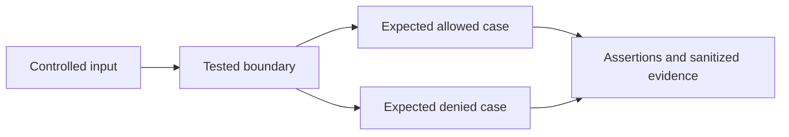

# AI Agent External Tool-Broker Lab

Status: **tested teaching implementation**. The surrounding production architecture in [`appsec/ai-agent-security.md`](../../appsec/ai-agent-security.md) is **conceptual and partially tested**.

This dependency-free Node.js lab demonstrates one narrow security boundary: a model may propose an action, but a broker outside the model decides whether a fake executor receives it. The executor stores an in-memory record and returns `status: simulated`; it performs no network, filesystem, financial, cloud, or other external action.

## Security properties exercised

The broker receives `authenticatedContext` separately from `proposedCall` and then:

- resolves a static server-side policy for the authenticated principal;
- rejects an unauthorized principal, tenant, tool, destination, or amount;
- accepts only a closed argument schema;
- requires approval at or above the configured impact threshold;
- asks an injected approval verifier for the authoritative approval record;
- binds approval to principal, tenant, tool, amount, and destination;
- consumes approval before execution to reject replay;
- checks an independently injected execution kill switch;
- emits sanitized decision and outcome events to an in-memory audit sink;
- invokes a fake executor only after all controls allow the call.

The tests assert that the fake executor's invocation count stays zero for denied actions. This distinction matters: a model may still propose a forbidden action, but it must not acquire authority by doing so.

## Run

From the repository root with Node.js 22 or newer:

```powershell
node --test labs/ai-agent-security/tests/broker.test.js
```

No package installation, environment variable, credential, service, container, or network connection is required.

## Files

- `broker.js` contains the broker and stable denial codes.
- `tests/broker.test.js` has tests for both what should work and what should get denied, plus the fake policy, approval store, audit sink, kill switch, and executor.

## Deliberate limitations

This is not a production authorization library. In particular:

- `authenticatedContext` is assumed to come from a trusted gateway. The lab does not validate a session, workload certificate, issuer, signature, audience, freshness, revocation, or tenant membership source.
- The policy is an in-process fixture. It has no administrative authorization, durable version, distribution, cache, or outage behavior.
- The approval verifier reads an in-memory map. It does not authenticate an approver, verify a signature, enforce separation of duties, or persist single-use state across processes.
- Replay state, audit events, and fake execution records are memory-only.
- The broker validates one teaching schema for a simulated payment-like action. A real broker needs a reviewed, versioned schema and constraints per tool.
- The lab does not implement MCP, OAuth, token exchange, downstream reauthorization, idempotency reconciliation, a sandbox, secret delivery, egress control, rate limiting, or durable incident evidence.

For production, derive identity and tenant outside the model, use a maintained authorization implementation, bind short-lived credentials to the selected resource, make the downstream service authorize again, and test fail-closed behavior at every boundary.

## Reproducibility and threat-model audit — 2026-11-02

| Element | Bounded experiment |
| --- | --- |
| Actor | Model controlling tool proposal and approval ID |
| Assets | tool authority, tenant/action binding and approval consumption |
| Entry points | JSON call and replayed approval |
| Boundary | Authenticated context → external broker → atomic in-memory consume → fake executor |
| Safety | Owned synthetic fixtures; no production data or cloud credentials; no cloud deployment |



### Complete local setup

Use a fresh repository checkout and the prerequisites above. From repository root:

```sh
npm ci --ignore-scripts
node --test labs/ai-agent-security/tests/broker.test.js
```

This is a local decision experiment, so the complete implementation is its tracked code, fixtures and policy files. It needs no Terraform deployment, service account or publicly exposed server. Never relocate fixture workflows into an active CI directory without a separate environment review.

### Evidence, expected output and interpretation

The documented command exits zero only when its assertions pass; an unexpected
allow/deny, schema or state result is a failure. Preserve the full command output
under ignored `.artifacts/research/` with runtime/tool versions and exit status.
Use the specific expected markers above rather than inventing example output.
The [lab audit](../../research-methodology/lab-audit.md) records the validation run.

No model, MCP transport, durable approval store or real downstream tool is executed. Local finite-case coverage is not a production false-positive or
false-negative estimate. TTD/TTC, representative pipeline overhead and monthly
cloud cost are **not measured in this lab**.

### Teardown and resources

The processes exit and remove their temporary test files. There is no cloud destroy command. Retained evidence, optional provider downloads and local Docker image cache are your only persistent outputs; remove them after review. Node dependencies can remain for subsequent runs.

Local CPU, memory, dependency downloads and optional image disk space are the resource cost. There is no measured cloud bill. Related research links above define which claims the experiment supports.

## References

- [Evidence contract](../../research-methodology/evidence-standards.md)

## Related maintained investigations

- [ai agent security](../../appsec/ai-agent-security.md)
- [evidence driven agent security](../../ai-security/evidence-driven-agent-security.md)
