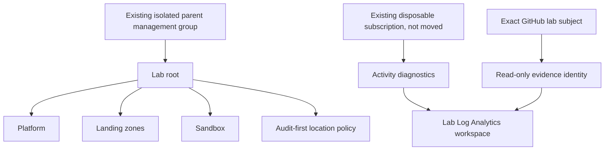

# Azure landing-zone hierarchy and policy lab

## Terraform objective and evidence boundary

**Partially tested:** the pinned AzureRM 4.50.0 provider validates the Terraform
schema and three mock-plan tests. No Azure token exchange, policy evaluation,
resource creation, subscription move or log delivery was executed. The older
Bicep example below is retained as an alternative compilation exercise.

### Threat model and architecture

A workload contributor must not change inherited policy or audit ownership. Assets
are hierarchy, policy, evidence identity and log coverage. Entry points are parent
moves, policy effects, federated subject and diagnostic configuration. Bootstrap
administration is trusted separately from a read-only evidence identity.



### Prerequisites and complete local validation — tested

Terraform >=1.7,<2, internet to initialize AzureRM 4.50.0, and about 1 GiB disk for
provider code. No Azure login or credential is needed for mocked tests.

```sh
bash labs/azure-landing-zone/validate.sh
```

Expected: schema validation succeeds and three runs pass: audit-first/scoped
identity, Disabled-policy rejection and wildcard-subject rejection. Mock plans
use all-zero synthetic UUIDs and never call Azure. Keep the generated provider
lockfile in version control. Source is [terraform/main.tf](terraform/main.tf).

### Management-group, identity, logging and guardrail assumptions

- The existing parent is an isolated lab parent in a dedicated tenant. A bootstrap
  identity would need narrowly reviewed hierarchy/policy rights there and resource,
  identity, diagnostic and role-assignment rights in the disposable subscription.
  This module deliberately does not grant its own bootstrap permissions.
- The subscription is **not moved** beneath the new hierarchy. Runtime policy
  inheritance for that subscription is **not established**. Never infer inherited
  enforcement from a hierarchy diagram or mock plan.
- Default policy effect is `audit`; it records noncompliance and does not block it.
  `deny` is an explicit input for a later impact-reviewed experiment. `Disabled`
  is rejected. Tenant-specific aliases and actual policy evaluation remain untested.
- The evidence identity receives `Log Analytics Reader` at the workspace only.
  Its exact issuer/audience/subject trust and GitHub environment must be separately
  checked with an actual non-production token exchange before use.
- Subscription activity categories Administrative, Policy and Security are sent
  to a lab workspace in the design. Data-plane services, Entra logs, independent
  log-archive protection and source freshness are outside it. The workspace is
  in the lab subscription and **is not an independent production archive**.
- Retention is 30 days and daily quota is 1 GiB. A quota is not a guaranteed bill
  cap and can cause monitoring gaps. No public service/network resource is created
  by the template, but workspace private connectivity is not configured here.

### Evidence, cost and cleanup

```sh
mkdir -p .artifacts/research
bash labs/azure-landing-zone/validate.sh > .artifacts/research/azure-terraform.txt 2>&1
```

No cloud resources exist to destroy. Remove local `.terraform/` downloads and
retained evidence after review, keeping `.terraform.lock.hcl`. A later authorized
cloud run would incur workspace ingestion/retention and possibly related service
charges; costs and policy/logging effectiveness are **not measured**. It requires
separate state, plan review and a reviewed destroy plan that first removes only
lab policy/diagnostic/role assignments, then lab identities/workspace/groups, then
empty child and root management groups. Never delete the existing parent, move
subscriptions, or weaken production inheritance as cleanup.

Read the [maintained landing-zone research](../../cloud-security/multi-account-landing-zones.md)
and [lab audit](../../research-methodology/lab-audit.md). The Azure experiment does
not establish AWS Organizations/SCP behavior.

## Historical alternative: Bicep compilation

This lab compiles a small tenant-scope Bicep design for a management-group hierarchy and an audit-first custom policy assignment. It demonstrates deployment shape, federated CI identity, and a reviewable what-if boundary; it does not deploy during repository validation.

## Architecture decision

The sample separates platform, landing-zone, and sandbox subscriptions beneath an organization root. The policy begins with `audit`, because changing a broad management-group policy to `deny` before impact analysis can interrupt workloads. Production design still needs connectivity, identity, security, decommissioned, and workload-archetype management groups based on the organization's operating model.

## Prerequisites and compile

- Azure CLI 2.83.0 or later with Bicep support.
- No Azure login is needed to compile.

```powershell
az bicep build --file labs/azure-landing-zone/main.bicep
```

Expected result: Bicep returns a compiled ARM template without diagnostics. The repository code validator performs this compilation when Azure CLI is available and reports an explicit limitation otherwise.

## What-if, not deployment

After replacing every angle-bracket placeholder, an authorized reviewer may inspect:

```sh
az login --tenant <tenant-id> --allow-no-subscriptions
az deployment tenant what-if \
 --name landing-zone-review \
 --location canadacentral \
 --template-file labs/azure-landing-zone/main.bicep \
 --parameters '@labs/azure-landing-zone/parameters.example.json'
```

The included workflow uses GitHub OIDC and a protected environment. Configure the federated credential with an exact repository/environment subject, constrain the service principal to the required tenant/management-group operations, and require a human review of the what-if artifact. Do not add a client secret.

## Deployment and rollback considerations

Management-group and policy changes have a wide blast radius. Roll out new policy in audit mode, inventory noncompliance, assign named exemption owners with expiry, pilot a narrow management group, then move to deny only with tested break-glass and rollback procedures. Removing a policy assignment does not undo resource mutations performed by `deployIfNotExists` or `modify`; this sample deliberately uses `audit`.

## Negative cases to review

- placeholder or duplicate management-group IDs;
- an OIDC subject broader than the protected environment;
- policy enforcement before exemptions and regional dependencies are inventoried;
- a hierarchy move that changes inherited role and policy scope;
- subscription vending without ownership, budget, network, logging, and lifecycle metadata;
- a tenant-level deployment identity with permanent credentials or excessive roles.

## Cleanup and limitations

Compilation creates `main.json`; remove that generated file after inspection. This lab does not execute what-if in CI because it has no authorized tenant, and it does not deploy, move subscriptions, create role assignments, configure networking, or validate tenant-specific Azure Policy aliases. What-if itself is predictive output, not proof of runtime correctness.

## References

- [Azure landing zones](https://learn.microsoft.com/en-us/azure/cloud-adoption-framework/ready/landing-zone/)
- [Landing-zone design areas](https://learn.microsoft.com/en-us/azure/cloud-adoption-framework/ready/landing-zone/design-areas)
- [Management-group design guidance](https://learn.microsoft.com/en-us/azure/cloud-adoption-framework/ready/landing-zone/design-area/resource-org-management-groups)
- [Subscription vending guidance](https://learn.microsoft.com/en-us/azure/cloud-adoption-framework/ready/landing-zone/design-area/subscription-vending)
- [Use GitHub OIDC to access Azure](https://learn.microsoft.com/en-us/azure/developer/github/connect-from-azure-openid-connect)

- [AzureRM 4.50.0 management-group source documentation](https://github.com/hashicorp/terraform-provider-azurerm/blob/v4.50.0/website/docs/r/management_group.html.markdown)
- [AzureRM 4.50.0 diagnostic setting source documentation](https://github.com/hashicorp/terraform-provider-azurerm/blob/v4.50.0/website/docs/r/monitor_diagnostic_setting.html.markdown)

## Related maintained investigations

- [multi account landing zones](../../cloud-security/multi-account-landing-zones.md)
