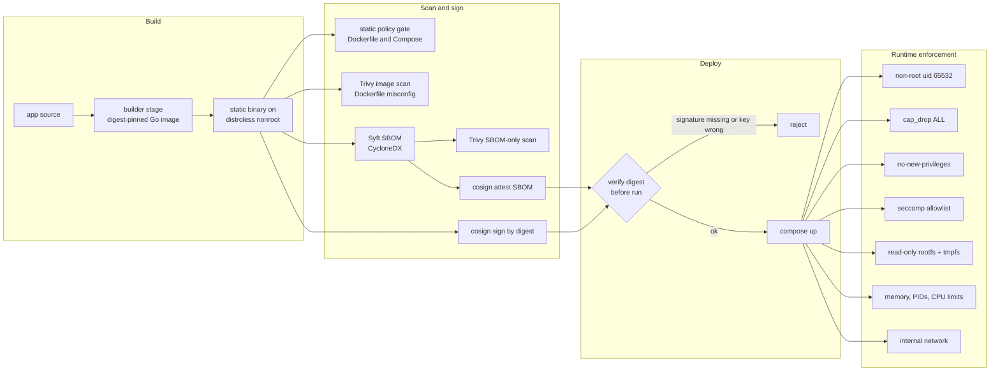

# Docker image and runtime hardening lab

**Status: partially tested.** The static policy gate runs anywhere and is part of `npm run validate`.
The runtime, scanning, SBOM and signing steps ran on one disposable VM on 2026-11-05 (85 of 85 assertions passed)
and are not wired into CI. AppArmor, rootless Docker, user-namespace remapping and a production signing trust
root were **not executed** (see [What was not tested](#what-was-not-tested)).

Evidence labels used on this page:

| Label | Meaning | Closest tier in the [evidence standards](../../research-methodology/evidence-standards.md) |
| --- | --- | --- |
| `tested locally` | I ran it in this lab and kept the output in [`evidence/`](https://github.com/jasonachkar/cybersecurity-writeups/tree/main/labs/docker-security/evidence) | T2/T3, T4 where the same case ran on both stacks |
| `source-reviewed` | I read it in the named primary source; not executed here | T0 |
| `policy model` | A rule set evaluated by a local test, not enforced by the real system | T1 |
| `requires-review` | No independent reviewer has checked it against its sources | review status of this page |

## Scope

One service, two configurations, one question: **what can code running inside the container do, and what changes when the
controls are on?** The service is a Go program of about 730 lines (standard library only) ([`app/main.go`](https://github.com/jasonachkar/cybersecurity-writeups/blob/main/labs/docker-security/app/main.go))
with an HTTP endpoint and a `probe` subcommand that tries a fixed list of benign operations (write the root filesystem,
`chown`, `mknod`, open a raw socket, `mount`, create a user namespace, reach the Docker socket, write a bind-mounted
directory, open a TCP connection) and reports the errno the kernel returned. Observing denials from inside the container
is the point; reading a Compose file and assuming it took effect is how hardening claims go wrong.

In scope: image build, base-image choice, user, filesystem, capabilities, `no-new-privileges`, seccomp, resource limits,
network topology, image scanning, SBOM, signing and verification by digest.

Out of scope: Kubernetes (see the [Kubernetes lab](../kubernetes-security/README.md)), runtime detection tooling, registry
operations, host hardening and anything that targets systems I do not own. Nothing here contacts a real cloud account,
production system or third-party service other than downloading base images and the Trivy vulnerability database.

> **Safety.** The insecure stack runs `privileged: true`, `pid: host` and mounts the Docker socket **on purpose**.
> Run `run-lab.sh` only on a throwaway VM or CI runner. The probe sends one read-only `GET /_ping` to the socket and
> nothing else; it creates no containers and changes no host state outside a temp directory the script owns.

## What I built

| Path | Purpose |
| --- | --- |
| `app/` | Go (stdlib only) service with `probe`, `healthcheck`, `forktest`, `memtest` subcommands, plus `k8sprobe` and `tcpcheck`, which the [Kubernetes lab](../kubernetes-security/README.md) reuses |
| `insecure/Dockerfile`, `insecure/compose.yaml` | Deliberately bad baseline; every line maps to a rule the gate must report |
| `hardened/Dockerfile`, `hardened/compose.yaml` | Same service, controls on |
| `hardened/seccomp.json` | Allowlist profile **derived** from `strace` of the shipped binary |
| `scripts/gen-seccomp.sh` | Derives the profile; prints which syscalls were service, harness, hand-off or removed |
| `scripts/run-lab.sh` | Builds, runs both stacks, runs controls, scans, signs, asserts, optionally publishes evidence |
| `scripts/scan.sh`, `scripts/sign-verify.sh` | Trivy + Syft; local registry + cosign with an ephemeral key |
| `tests/policy-check.js` (+ `.test.js`) | Static Dockerfile/Compose gate; 38 tests, a positive and a negative case per rule |
| `tests/runtime_check.py`, `inventory.py`, `summarize_scan.py` | Assertions on observed output, image attack-surface inventory, scan dedup |
| `evidence/` | Sanitized output of the run described below |



*Status: the pipeline in this diagram is a design diagram. Every box except "verify digest before run" was executed by
`run-lab.sh`; verification was executed as a command (`cosign verify`) but **nothing in this lab refuses to start an
unsigned image**. Enforcement at deploy time needs an admission controller or a deploy wrapper; the
[Kubernetes lab](../kubernetes-security/README.md) models that decision.*

## Attack surface and threat model

| Element | Declared scope |
| --- | --- |
| Actor | Code running as the container's main process: a compromised dependency, an RCE in the service, or a malicious image layer |
| Assets | The host kernel and filesystem, the Docker daemon, neighbouring containers, the service's own data |
| Entry points | Anything the process can call: syscalls, mounted paths, sockets, network |
| Trust boundary | Container process → kernel (namespaces, capabilities, seccomp, cgroups) → host |
| Not in scope | A kernel vulnerability or runc escape; hardening reduces reachable kernel surface but cannot make a shared kernel a hard multi-tenant boundary |

The insecure configuration is built to expose each of these at once: root, full capability set, no syscall filter,
host PID namespace, Docker socket, writable bind mount, writable root filesystem, no limits, all-interface port.

## Control decisions

Each row names what the control prevents **and what it does not**. The last column is the cost I would expect to pay.

| Control | Insecure | Hardened | Stops | Does not stop | Cost / false-positive risk |
| --- | --- | --- | --- | --- | --- |
| Base image | `golang:1.27-alpine` (toolchain, `apk`, shell ship in runtime), tag only | distroless `static-debian12:nonroot`, tag + digest | Post-exploitation tooling: no shell, package manager or compiler | Vulnerable code in the binary itself | No shell means no `docker exec sh`; debug with an ephemeral debug container or a separate debug image |
| User | root (uid 0) | `65532:65532` | Writing root-owned files, binding <1024 without caps | Kernel bugs reachable by unprivileged users | Bind-mounted volumes must be writable by that uid; fails at start, visibly |
| Capabilities | 40 effective (privileged) | `cap_drop: ALL`, `CapEff=0` | `chown`, `mknod`, raw sockets, `mount` via `CAP_*` checks | Anything that needs no capability | Needs `NET_BIND_SERVICE` for port 80/443 unless you remap ports; ping needs `NET_RAW` |
| `no-new-privileges` | `NoNewPrivs: 0` | `NoNewPrivs: 1` | setuid/file-capability privilege gain on `execve` | A process that is already privileged | Breaks legitimate setuid helpers (`sudo`, `ping` on some images) |
| Seccomp | none (`Seccomp: 0`) | allowlist, default `ERRNO` | Namespace creation via `clone`, `mount`, `ptrace`, `bpf`, module loading, `open_by_handle_at` | Abuse of syscalls that remain allowed | Highest false-positive risk of any control here; see [Seccomp profile](#seccomp-profile) |
| Root filesystem | writable | `read_only: true` + 8 MiB `noexec` tmpfs on `/tmp` | Persisting a payload or tampering with binaries in the image layer | Memory-only attacks; writes to any mounted volume | Every writable path must be enumerated; apps that write to `/var/cache` break at runtime |
| Resource limits | none | 128 MiB (no swap), 64 PIDs, 0.5 CPU | Memory exhaustion, fork exhaustion, CPU starvation of neighbours | Network or disk-bandwidth exhaustion | An undersized limit is an availability incident, not a security event; size from measured peaks |
| Namespaces | `pid: host` | own PID namespace | Enumerating and signalling host processes | — | None for this app |
| Socket / mounts | Docker socket, writable host dir | none | Daemon API access (host-root equivalent), host file tampering | — | CI runners and reverse proxies often *want* the socket; give them a socket proxy or a rootless daemon instead |
| Network | default bridge, `0.0.0.0:8080` | `internal: true`, no published port | Egress to anything outside the network; reachability of the canary | Abuse of what the app is allowed to talk to | An internal-only service needs a second hop for ingress (a proxy on both networks) |
| Supply chain | unpinned tag, no signature | digest pins, SBOM, cosign signature + attestation | Tag substitution; unverified bytes | A compromised build pipeline that signs bad bytes | Digest pins stop receiving base-image fixes until bumped (observed below) |

### Seccomp profile

I did not copy a profile. `scripts/gen-seccomp.sh` extracts `/app/posture` from the built image, runs it under
`strace -f` for the service workload and the lab-harness subcommands, **removes** a fixed deny list the probe attempts on
purpose (strace records an attempt even when the kernel refuses it, so without this step the profile would learn the
attacks), and emits a default-`ERRNO` allowlist. Observed on this run:

```text
service syscalls allowed : 41
runtime hand-off allowed : 3  ['fstatfs', 'statfs', 'statx']
harness-only allowed     : 9  ['dup3', 'mkdirat', 'newfstatat', 'pidfd_open', 'pidfd_send_signal', 'pipe2', 'readlinkat', 'unlinkat', 'waitid']
observed but removed     : 4  ['fchownat', 'mknodat', 'mount', 'umount2']
```

*Status: `tested locally`. The output above is from the run that generated the committed `hardened/seccomp.json`.*

Three things I learned the hard way, all observed:

1. **An application trace is not enough.** The first profile left the container unable to start: `runc init` itself issues
   syscalls after the filter is loaded and before `execve`. On runc 1.5.2 the failure walked from `fstatfs` to `statx`
   before the container came up. That "hand-off" set is runtime-version dependent; re-derive it when runc changes.
2. **`clone` needs an argument filter, not an allow.** The profile allows `clone` only when
   `flags & 0x7E020000 == 0` (the namespace flags) and returns `ENOSYS` for `clone3`, because seccomp cannot inspect the
   `clone3` flags struct and libc/Go fall back to `clone`. This matches the structure of Moby's default profile
   (`source-reviewed`: `moby/profiles` `seccomp/default.json`, which uses the same `2114060288` mask and `errnoRet: 38`
   for `clone3` when `CAP_SYS_ADMIN` is absent).
3. **A denial is only evidence if you know which layer produced it.** `mount`, `chown`, `mknod` and raw sockets are
   refused by capability checks as well, so they cannot show that seccomp works. User-namespace creation through
   `clone(CLONE_NEWUSER)` needs no capability (Docker's seccomp documentation calls this out), so it is the discriminating
   probe. I also tried `unshare(CLONE_NEWUSER)` first and got `EINVAL` even with every restriction off (`tested locally`).
   `unshare(2)` documents `EINVAL` for `CLONE_NEWUSER` when the caller is multithreaded (`source-reviewed`), and a Go
   program is always multithreaded. A probe that fails for an unrelated reason would have looked like a pass.

The default action is `ERRNO`, not `KILL`. A missed syscall then degrades one request instead of killing PID 1 and
restart-looping the service. The cost is that a blocked syscall can be swallowed by code that ignores errors.

### Image scanning: what the numbers say, and what they do not

This is where my expectation was wrong, so I am recording it as found. `tested locally`, Trivy 0.76.1, vulnerability DB
updated 2026-11-04 19:02 UTC, both images built from `golang:1.27-alpine` (Go 1.27.3):

| Measure | insecure (`alpine 3.24.3` + toolchain) | hardened (`debian 12.15` distroless) |
| --- | --- | --- |
| Unique CVE/package findings | **0** | **4** (all `UNKNOWN` severity: Debian LTS advisories against `ca-certificates` and `tzdata`; fixed versions exist) |
| SBOM-only scan (`trivy sbom` on the Syft CycloneDX file) | 0 | 4 (agrees with the image scan) |
| SBOM components by type | 39 library, 213 file, 1 application, 1 OS | 7 library, 950 file, 1 OS |
| Executable files in the image | 86 | 10 |
| Shell / package manager / compiler | `ash`+`sh` / `apk` / `go` | none / none / none |
| Image content size | 356,984,047 bytes | 9,404,585 bytes |

Reading it correctly:

- **A CVE count did not rank these images by risk.** The image with a shell, a package manager and a compiler had no known
  vulnerabilities on the day it was scanned; the hardened image had four. The hardened image's *attack surface* is far
  smaller, which is why the lab measures it directly (`tests/inventory.py` walks the exported filesystem) instead of
  trusting scan counts.
- **The hardened image is older on purpose, and that is a trade.** Pinning the distroless base by digest makes the build
  reproducible and stops a registry-side tag move from changing what you run. It also freezes the base at the digest I pinned,
  so Debian updates that landed afterwards show up as findings. Digest pinning only works with automation that bumps the
  digest (Renovate/Dependabot or a scheduled rebuild) and re-scans. I did not build that automation here.
- **Raw counts mislead; deduplicate.** An earlier scan of the same two images built from `golang:1.24-alpine` reported 976 raw
  findings for the insecure image, which collapse to 116 unique CVE/package pairs because the same Go standard-library CVEs
  repeat for every Go binary in the toolchain. The hardened image, then, carried 23 HIGH findings from the toolchain's standard
  library. Those two scans are kept as a clearly-labeled one-off record,
  [`observation-go124-toolchain-scan.json`](https://github.com/jasonachkar/cybersecurity-writeups/blob/main/labs/docker-security/evidence/observation-go124-toolchain-scan.json),
  and **cannot be regenerated**: the images no longer exist and the DB moves daily. Moving the builder to a supported toolchain
  removed them. The lesson is that "distroless" does not mean "no findings": a statically linked Go binary carries its toolchain's
  standard library.
- **SBOM totals are not comparable.** 958 vs 254 components looks like the opposite of the truth; file-level components
  (every zoneinfo file in `tzdata`) dominate. Compare package-level components.
- **Trivy's Dockerfile checks agreed with my gate on the big items.** It flagged the insecure Dockerfile for root user
  (`DS-0002`, HIGH), no `HEALTHCHECK` (`DS-0026`) and the secret-shaped `ENV` (`DS-0031`, CRITICAL) and reported nothing
  for the hardened one. My gate reports 30 findings vs 0 because it also covers Compose.

### Signing: what local-only signing proves

`scripts/sign-verify.sh` runs a `registry:2` container on loopback, generates an **ephemeral** key pair with a random
one-time password (never written to disk or committed), and signs with an empty signing config (no Fulcio, Rekor or TSA).
cosign v3 deprecates `--tlog-upload=false`; an explicit empty signing config is the supported way to say "no transparency
service". Results (`tested locally`, `evidence/signing__summary.json`):

| Case | Expected | Observed |
| --- | --- | --- |
| Verify the signed hardened digest, right key | accept | accepted |
| Verify the unsigned insecure digest | reject | rejected (`no signatures found`) |
| Verify the signed digest with an unrelated key | reject | rejected |
| Verify by tag, then re-point the tag at different content and verify again | accept, then reject | accepted, then rejected |
| Verify the SBOM attestation (`cyclonedx`) | accept | accepted |
| Verify the same digest as `slsaprovenance` | reject | rejected |

This proves the **mechanics**: a signature binds to a digest, so tag substitution fails verification. It does **not** prove:
who signed (the key is anonymous), when (no transparency log or timestamp), or that the signer was your pipeline. Production
needs keyless signing bound to a CI workload identity or a KMS/HSM key, a transparency log, and verification at admission
against a pinned identity. The existing [Kubernetes lab](../kubernetes-security/README.md) contains the admission-side
`ImageValidatingPolicy` and its offline model; neither is exercised against a real signature here.

## Validation

All commands run from the repository root. Environment for the recorded run (`evidence/versions.txt`): Linux kernel
6.18.44, Docker Engine 29.9.2 (overlayfs snapshotter, **cgroup v1**), Compose 5.6.1, runc 1.5.2, Trivy 0.76.1, Syft 1.56.0,
cosign v3.1.4, strace 6.8. `docker info` listed only `seccomp` under security options.

```bash
node --test labs/docker-security/tests/policy-check.test.js     # no Docker needed
bash labs/docker-security/scripts/run-lab.sh --publish-evidence  # needs a disposable Docker host
```

### Static gate (`tested locally`, no Docker)

`node labs/docker-security/tests/policy-check.js labs/docker-security/insecure` → **30 findings**, exit 1.
`... hardened` → **0 findings**, exit 0. 38 unit tests pass: one positive and one negative case per rule, plus the cases
below. Writing them found a real defect in my own rule: `docker.sock:ro` evaded the socket rule because the regex anchored
on end-of-string. A read-only mount of a socket file does not restrict API calls, so the rule now matches `:ro`,
`containerd.sock`, `podman.sock` and `crio.sock` as well.

### Runtime comparison (`tested locally`)

Observed from inside the running service containers via `docker compose exec ... probe` (`evidence/runtime__*-probe.json`):

| Observation | Insecure | Hardened |
| --- | --- | --- |
| Effective uid | 0 | 65532 |
| `CapEff` | `000001fffeffffff` (40 capabilities, no `SYS_RESOURCE` because this VM drops it) | `0000000000000000` |
| `NoNewPrivs` / `Seccomp` | 0 / 0 (off) | 1 / 2 (filter, 1 filter) |
| Root filesystem | writable | read-only |
| Memory / PIDs / CPU | unlimited / unlimited / unlimited | 134217728 / 64 / 50000 µs per 100000 |
| Visible processes, PID 1 | 96, the VM's init (`host` PID namespace) | 2, `posture` |
| `write_root_filesystem` | allowed | `EROFS` |
| `write_tmp_scratch` | allowed | allowed (the app still works) |
| `chown_to_other_uid`, `mknod_char_device`, `raw_socket`, `mount_tmpfs` | allowed | `EPERM` each |
| `clone_new_user_namespace` | allowed | `EPERM` |
| Docker socket | present, `GET /_ping` → `HTTP/1.0 200 OK` | `ENOENT` |
| Bind-mounted host directory | read and write allowed; file written by the container is **owned by uid 0 on the host** | `ENOENT` |
| TCP to the canary service | allowed | blocked, name does not resolve (different network) |

Seccomp attribution controls (same user, caps dropped, `no-new-privileges`, read-only; only `--security-opt seccomp`
varies, `evidence/runtime__hardened-seccomp-*-probe.json`):

| seccomp setting | `Seccomp` mode | `clone(CLONE_NEWUSER)` |
| --- | --- | --- |
| `unconfined` | 0 | **allowed** |
| Docker default profile | 2 | `EPERM` |
| this lab's derived profile | 2 | `EPERM` |

With capabilities already empty, the only thing that changes between rows is the seccomp setting. That is what makes the
denial attributable to the filter.

Resource limits:

| Test | Insecure | Hardened |
| --- | --- | --- |
| `forktest 200` (bounded: sleeping children, then exit) | 200 started | 13 started, `EAGAIN` (Go runtime threads count against the 64-PID limit) |
| `memtest 512` (touch 512 MiB) | exit 0 | killed, **exit 137**; last progress line `touched_mib: 112` |

After the hardened OOM kill, Docker reported `running oom_killed=true health=healthy`. The kernel killed the exec'd test
process, not PID 1, so the service stayed up. That is OOM victim selection, not a guarantee: a leak in the service itself
would be the victim, and Docker's own documentation notes the kernel kills processes in a container when it hits its
limit. Treat limits as availability controls.

### What the lab asserts

`run-lab.sh` ends by running `tests/runtime_check.py`, which exits nonzero when any observed value differs from the claims
above: `85 passed, 0 failed` on the recorded run. Supply-chain assertions print `SKIP` with the recorded reason when
Trivy, Syft or cosign are absent, never a silent pass.

## What was not tested

- **AppArmor / SELinux profiles.** `docker info` showed `name=seccomp` only; `/sys/kernel/security/lsm` does not exist on
  this VM kernel, so no LSM profile could be loaded. Not executed. Docker's security documentation describes AppArmor and
  SELinux as an additional layer; whatever a production host adds on top of the controls measured here is unmeasured.
- **Rootless Docker and `userns-remap`.** Not executed. These change what "uid 0 in the container" means and are the control
  I would add for workloads that must run as root.
- **cgroup v2.** The run was on cgroup v1. The probe reads both layouts, but the v2 paths were not exercised.
- **Windows, macOS/Docker Desktop, Podman, containerd-direct.**
- **Hosted CI.** `run-lab.sh` is not part of `npm run verify:native-labs`; adding a privileged-container job to the gating
  workflow without a hosted-runner trial would risk blocking publication. Static tests are in `npm run validate`.
- **Keyless signing, Rekor, a transparency-log-backed verification, KMS keys.** Local ephemeral key only.
- **Runtime detection** (Falco, Tetragon, auditd) for the behaviours the probe exercises. See the
  [Linux telemetry lab](../linux-host-telemetry/README.md) for synthetic detection logic.
- **Escape techniques.** The lab does not attempt container escapes, and a passing run is not a claim that none exist.
- **Reproducible builds.** The two images rebuild with different digests each time; `-trimpath` and a pinned builder narrow
  the gap but I did not verify bit-for-bit reproducibility.

## Production considerations

**Rollout.** Do not enable everything at once. Order by blast radius and ease of rollback: (1) digest pins and non-root,
(2) `no-new-privileges` and `cap_drop: ALL` with a measured add-back list, (3) read-only root with a tmpfs inventory,
(4) resource limits from observed peaks plus headroom, (5) seccomp last, in a lower environment first.
For seccomp, ship `SCMP_ACT_LOG` (needs `auditd`/journald) for at least one full release cycle and review the denied
syscalls before switching to `ERRNO`; this lab went straight to `ERRNO` because its workload is fully enumerated.

**False positives.** The things that break first are exactly the things hardening removes: apps that write outside
declared paths (`EROFS`), images that expect root-owned volumes (`EACCES`), services that silently ignore `EPERM`
from a blocked syscall, setuid helpers, JIT runtimes and anything calling `clone3`. A seccomp profile learned from a
bounded workload **will** miss rare paths (a reload handler, a crash dumper, a TLS renegotiation path); mitigate with
staged `LOG` mode, a regression test that exercises every code path, and a per-service exception process.

**Detection.** Alert on the configuration, not only the behaviour: `privileged`, `cap_add`, `docker.sock` mounts,
`pid: host`, `seccomp=unconfined` and writable host bind mounts at CI/admission time (this lab's gate is a starting point).
At runtime, a container that performs `mount`, namespace creation or writes to a read-only path is a signal only if you collect
the denial; `EPERM` from seccomp is silent unless you configure logging. I did not test a runtime sensor.

**Operability.** Debugging a shell-less image needs a documented procedure (ephemeral debug container sharing the PID
namespace, or a debug tag of the image that is *never* deployed to production). Health checks must not assume `curl`.
Exit 137 after a limit change is the OOM killer, not a crash loop. Track image age: a digest-pinned base that nobody bumps
becomes the scan finding you are paying to avoid.

**Blast radius.** Even fully hardened, containers share the host kernel. The controls here shrink reachable kernel
surface and what an attacker can do post-exploit; they do not make this safe for hostile multi-tenant code. For that, add
a user-namespaced or VM-isolated runtime (gVisor, Kata, Firecracker) and say so in the threat model.

**Rollback.** Everything is declarative: revert the image digest or the Compose file. Keep the previous profile versioned
beside the image tag. The break-glass setting `seccomp=unconfined` is dangerous precisely because it works; make it a
time-boxed exception that alerts, never a default fix for a failing deploy.

## Reproduce

Prerequisites: Docker Engine with Compose v2, Node.js 22+ (`npm ci --ignore-scripts` for the `yaml` dependency),
Python 3. Optional, each recorded as `not executed` when absent: `trivy`, `syft`, `cosign` (versions above), and `strace`
only to regenerate the profile.

```bash
npm ci --ignore-scripts
node --test labs/docker-security/tests/policy-check.test.js
bash labs/docker-security/scripts/run-lab.sh                      # raw output in .artifacts/research/docker-security/
bash labs/docker-security/scripts/gen-seccomp.sh                  # optional: regenerate hardened/seccomp.json
```

Expect Trivy results to differ from the table above: the vulnerability database changes daily, and Docker Hub may rate-limit
base-image pulls (I hit HTTP 429 once during development; a retry succeeded).

**Teardown.** `run-lab.sh` removes both stacks, the registry container, the canary directory and its temp key material on
exit. Images (`dockerlab/posture:*`) and the base-image cache remain; remove them with `docker image rm`.

## References

Only sources I read while building this lab. The vendor documentation sites were not reachable from the build environment,
so documentation is cited at its source repository, which is the file I actually read.

- Docker documentation source, [seccomp security profiles](https://github.com/docker/docs/blob/main/content/manuals/engine/security/seccomp.md): default profile is an allowlist, 44 syscalls blocked out of 300+, `clone` namespace gating and the `CLONE_NEWUSER` exception.
- Moby, [default seccomp profile](https://github.com/moby/profiles/blob/main/seccomp/default.json): `clone` argument mask `2114060288`, `clone3` → `errnoRet: 38` without `CAP_SYS_ADMIN`.
- Docker documentation source, [resource constraints](https://github.com/docker/docs/blob/main/content/manuals/engine/containers/resource_constraints.md): OOM behaviour, `--memory-swap` semantics.
- Docker documentation source, [Docker Engine security](https://github.com/docker/docs/blob/main/content/manuals/engine/security/_index.md) (AppArmor/SELinux as an additional layer) and [build best practices](https://github.com/docker/docs/blob/main/content/manuals/build/building/best-practices.md) (multi-stage builds, minimal base images, pinning to a digest, updating pins on a schedule).
- Linux man-pages, [unshare(2)](https://github.com/mkerrisk/man-pages/blob/master/man2/unshare.2): `EINVAL` for `CLONE_NEWUSER` from a multithreaded caller.
- Linux kernel documentation, [seccomp BPF filters](https://github.com/torvalds/linux/blob/master/Documentation/userspace-api/seccomp_filter.rst) and [no_new_privs](https://github.com/torvalds/linux/blob/master/Documentation/userspace-api/no_new_privs.rst): a filter requires `no_new_privs` or `CAP_SYS_ADMIN`.
- Sigstore, [cosign sign reference](https://github.com/sigstore/cosign/blob/main/doc/cosign_sign.md). Flag behaviour for v3.1.4 (signing config, deprecated `--tlog-upload`) was read from the binary's own error text and `signing-config create --help`.
- Trivy, Syft, cosign, Docker, runc and Compose versions: the tools' own `version` output, recorded in `evidence/versions.txt`.

## Related maintained investigations

- [Kubernetes admission, network, and image-policy lab](../kubernetes-security/README.md)
- [Artifact provenance and SBOM verification](../supply-chain/README.md)
- [Software supply-chain evidence](../../devsecops/supply-chain-sbom-signing.md)
- [Kubernetes multi-tenancy](../../cloud-security/kubernetes-multi-tenancy.md)
- [Linux host telemetry detection lab](../linux-host-telemetry/README.md)
