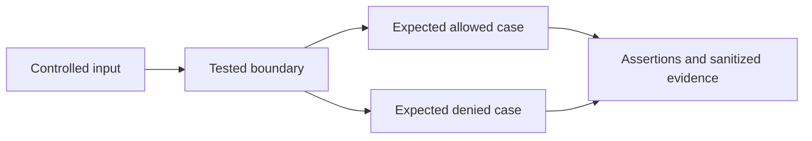

# Terraform plan and Rego policy lab

This lab demonstrates why source scanning, plan evaluation, provider-side controls, and drift monitoring are separate layers. It does not deploy infrastructure.

## Tested scope

- Terraform CLI `1.14.6` for formatting and offline initialization/validation.
- Open Policy Agent `1.17.0` for Rego v1 unit tests and fixture evaluation.
- Terraform plan JSON fixtures use `format_version: "1.2"` and intentionally model only the resource shapes consumed by the policy.

Run the dependency-free structural tests:

```text
node labs/iac-policy/tests/run-tests.js
```

Run the native policy tests against each positive or negative serialized-plan fixture:

```text
opa test labs/iac-policy/policy/terraform.rego labs/iac-policy/policy/secure_fixture_test.rego labs/iac-policy/fixtures/secure_plan.json -v
opa test labs/iac-policy/policy/terraform.rego labs/iac-policy/policy/insecure_fixture_test.rego labs/iac-policy/fixtures/insecure_plan.json -v
opa test labs/iac-policy/policy/terraform.rego labs/iac-policy/policy/unknown_fixture_test.rego labs/iac-policy/fixtures/unknown_plan.json -v
opa test labs/iac-policy/policy/terraform.rego labs/iac-policy/policy/deleted_fixture_test.rego labs/iac-policy/fixtures/deleted_control_plan.json -v
```

Validate the two backend examples without contacting AWS:

```text
terraform -chdir=labs/iac-policy/terraform/insecure init -backend=false
terraform -chdir=labs/iac-policy/terraform/insecure validate
terraform -chdir=labs/iac-policy/terraform/hardened init -backend=false
terraform -chdir=labs/iac-policy/terraform/hardened validate
```

## Evidence and negative cases

`fixtures/secure_plan.json` is accepted. The negative fixtures demonstrate:

- public object-storage configuration and absent public-access controls;
- absent encryption and access logging;
- unrestricted network ingress;
- a public, unencrypted database;
- wildcard IAM permissions;
- missing authorization-driving tags;
- security-relevant values that are unknown at policy-evaluation time; and
- deletion of a public-access control.

The Rego policy fails closed for the modeled unknown values. That is a policy choice: some organizations instead defer a decision until values are known. If you defer the decision, whatever checks it later still has to block until it's actually known.

## Backend comparison

The insecure example embeds a deprecated DynamoDB lock table and does not opt into S3 lockfile locking, version recovery, or KMS encryption. The hardened example uses `use_lockfile = true`, an explicit KMS key, and documents the S3 permissions required for the state and `.tflock` objects. Bucket versioning, access logging, and the KMS key are bootstrap controls outside the backend block and must be enforced separately.

`sensitive = true` affects CLI/UI display; it does not remove a value from state. State readers should therefore be treated as readers of potentially sensitive data.

## Limitations

- The plan fixtures are reviewed test inputs, not output from a live cloud account.
- This policy covers a deliberately small AWS resource set. It is not a complete cloud security baseline.
- Terraform validation checks syntax and internal consistency. It does not prove that backend permissions, KMS policy, provider behavior, or runtime state match the design.
- OPA plan evaluation cannot replace service control policies, cloud configuration rules, posture management, or drift investigation.

## Reproducibility and threat-model audit — 2026-11-02

| Element | Bounded experiment |
| --- | --- |
| Actor | Infrastructure contributor or compromised serialized plan |
| Assets | security controls, state backend and apply authority |
| Entry points | known, unknown or deleted resource state |
| Boundary | Plan JSON → native Rego decision → separately reviewed apply artifact |
| Safety | Owned synthetic fixtures; no production data or cloud credentials; no cloud deployment |



### Complete local setup

Use a fresh repository checkout and the prerequisites above. From repository root:

```sh
npm ci --ignore-scripts
node labs/iac-policy/tests/run-tests.js
bash labs/iac-policy/validate-opa.sh
```

The native policy script uses installed OPA or the pinned official Docker image. It mounts this lab read-only and disables runtime networking; no cloud resources are deployed. Backend examples support `init -backend=false` and `validate` only.

This is a local decision experiment, so the complete implementation is its tracked code, fixtures and policy files. It needs no Terraform deployment, service account or publicly exposed server. Never relocate fixture workflows into an active CI directory without a separate environment review.

### Evidence, expected output and interpretation

The documented command exits zero only when its assertions pass; an unexpected
allow/deny, schema or state result is a failure. Preserve the full command output
under ignored `.artifacts/research/` with runtime/tool versions and exit status.
Use the specific expected markers above rather than inventing example output.
The [lab audit](../../research-methodology/lab-audit.md) records the validation run.

Node tests are structural; native OPA tests establish only the supplied plan shapes. No cloud provider API or apply is executed. Local finite-case coverage is not a production false-positive or
false-negative estimate. TTD/TTC, representative pipeline overhead and monthly
cloud cost are **not measured in this lab**.

### Teardown and resources

The processes exit and remove their temporary test files. There is no cloud destroy command. Retained evidence, optional provider downloads and local Docker image cache are your only persistent outputs; remove them after review. Node dependencies can remain for subsequent runs.

Local CPU, memory, dependency downloads and optional image disk space are the resource cost. There is no measured cloud bill. Related research links above define which claims the experiment supports.

## References

- [Terraform S3 backend and lockfile](https://developer.hashicorp.com/terraform/language/backend/s3)
- [Terraform state and sensitive data](https://developer.hashicorp.com/terraform/language/state/sensitive-data)
- [Terraform JSON output format](https://developer.hashicorp.com/terraform/internals/json-format)
- [OPA policy testing](https://www.openpolicyagent.org/docs/policy-testing)

## Related maintained investigations

- [iac security and policy as code](../../devsecops/iac-security-and-policy-as-code.md)
