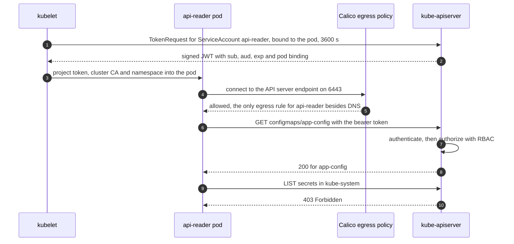
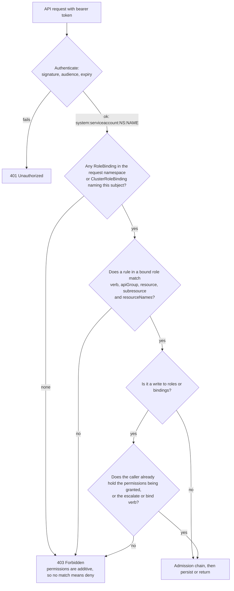
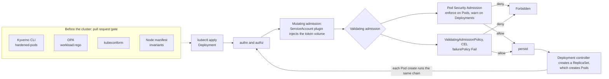
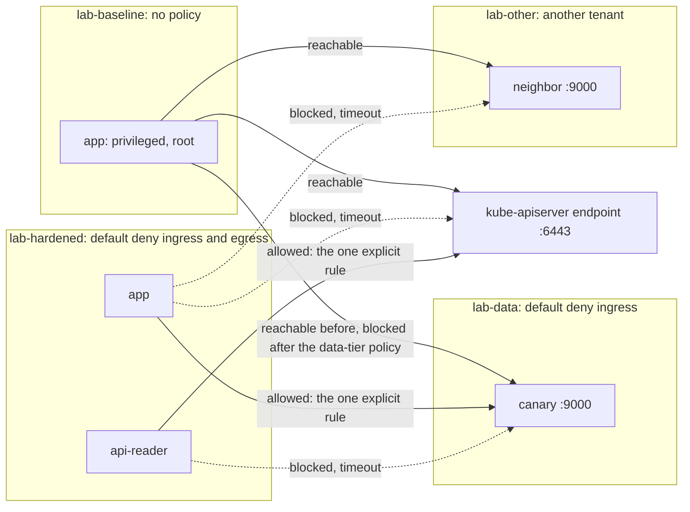
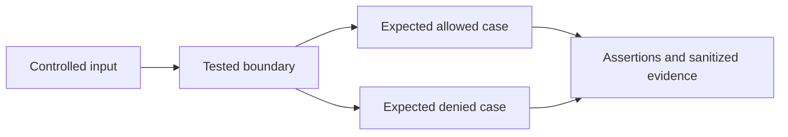

# Kubernetes admission, network, and image-policy lab

**Status: partially tested.** Two layers of evidence live here:

1. **Offline** (runs in CI): Kyverno CLI 1.18.2 over the pod-hardening policy and the admission case corpus, OPA/Rego unit and
   manifest tests, kubeconform, and Node tests that pin the manifests' structure. The Node tests are part of
   `npm run validate`; the Kyverno tests and the new Rego check (`validate-rego.sh`, which has not yet run on a hosted runner) are
   part of `npm run verify:native-labs`; kubeconform was run locally only.
2. **Live** (one disposable kind cluster, run once on 2026-11-05, 83 of 83 assertions passed): Kubernetes v1.37.0 with a
   policy-enforcing CNI, real API calls from inside pods, real Pod Security Admission and ValidatingAdmissionPolicy decisions,
   real connectivity tests. Not wired into CI.

The image-verification policy remains a schema-validated example with an offline decision model (see
[Existing offline fixtures](#existing-offline-fixtures-kept-unchanged)); signature, certificate, registry, transparency,
mutation and live admission of signed images were **not** executed.

Evidence labels: `tested locally` (executed here, output kept in [`evidence/`](https://github.com/jasonachkar/cybersecurity-writeups/tree/main/labs/kubernetes-security/evidence)),
`source-reviewed` (read in the named primary source, not executed), `policy model` (a rule set evaluated by a local test, not
enforced by the real system) and `requires-review` (no independent reviewer has checked it). They map to T2/T3 and T4, T0, T1 and
review status in the [evidence standards](../../research-methodology/evidence-standards.md).

## Scope

One question: **what can a compromised workload do, as seen from inside the cluster, and which control changes the answer?**
Four properties are measured on an insecure baseline and a hardened equivalent, using the same application image family as the
[Docker lab](../docker-security/README.md):

| Property | How it is measured |
| --- | --- |
| Workload identity | A `k8sprobe` subcommand in the pod calls the API with the pod's own token and records HTTP status codes and item **counts** only (never names or values), plus `SelfSubjectAccessReview` for write permissions so it changes nothing |
| Permissions | `kubectl auth can-i` as the ServiceAccount, cross-checked against the in-pod result |
| Network reachability | `tcpcheck` from inside each pod to a data-tier canary, another tenant's canary, and the API server endpoint |
| Runtime constraints | The Docker lab's `probe` run inside the pod: uid, capabilities, `NoNewPrivs`, seccomp, read-only root, cgroup limits, denied syscalls |

Out of scope: multi-node scheduling, node hardening, etcd encryption, API-server audit logging, service mesh, cloud IAM, and any
cluster that is not the kind cluster this lab creates and deletes. A namespace, a PSA label or a NetworkPolicy is **not** a hostile
multi-tenant boundary; see the [Kubernetes multi-tenancy research](../../cloud-security/kubernetes-multi-tenancy.md).

## What I built

| Path | Purpose |
| --- | --- |
| `cluster/` | kind config (portable and a compatibility variant), `up.sh` (kind + Calico with a pinned manifest SHA-256 + preloaded images), `down.sh` |
| `baseline/` | Insecure manifests: over-granted ServiceAccount, privileged root container with `hostPID` and `hostPath`, no NetworkPolicy, no admission labels, plus the two canary fixtures |
| `hardened/` | PSA `restricted` namespace, least-privilege RBAC, restricted workloads, default-deny NetworkPolicies, a CEL `ValidatingAdmissionPolicy` |
| `admission-cases/` | 16 pods, each differing from a compliant pod in one property; `expectations.json` (predictions written before the engines ran); a Kyverno CLI test |
| `policies/rego/` | `workload.rego` (pod, RBAC, namespace and NetworkPolicy rules) and 12 unit tests |
| `scripts/` | `np-smoke.sh`, `admission-matrix.js`, `run-cluster-lab.sh`, `manifests-to-input.js`, `publish_evidence.py` |
| `tests/` | `manifests.test.js` (16 structural tests), `cluster_check.py` (assertions on observed output), existing `run-tests.js` |
| `evidence/` | Sanitized output of the run described below, plus two labeled one-off observations |
| `policies/hardened-pods.yaml`, `verify-release-images.yaml`, `fixtures/` | Existing; unchanged |

## Architecture

### Pod identity to the Kubernetes API



*Status: `tested locally`. The last four steps are the `hardened-apireader-k8sprobe.json` result: a `GET` of the one named ConfigMap
returned 200; every list and the write and escalation reviews were denied. The token was bound to the pod with about 3594 s remaining.*

### RBAC decision flow



*Status: `source-reviewed` against the RBAC reference (permissions are purely additive; role and binding writes are limited by privilege
escalation prevention) and consistent with the live results: the baseline identity could list `secrets` in `kube-system` and create
`pods/exec`, yet `escalate` and `impersonate` were **denied**, because the over-grant was deliberately not cluster-admin.*

### Admission control flow



*Status: `tested locally`. The Deployment was accepted with a PSA **warning**; the ReplicaSet's pod creation was refused with
`violates PodSecurity "restricted:v1.37"` and zero pods existed (`hardened-rejects-baseline-workload.txt`). The mutating step is
inferred from an observed effect: `gap-automounted-token` carries no token volume in its spec, yet the ValidatingAdmissionPolicy
denied it for having one, so the policy saw a volume the ServiceAccount plugin had injected.*

### Network segmentation and lateral-movement boundaries



*Status: `tested locally` under Calico v3.33.0, after the enforcement smoke test passed. DNS egress is allowed for both hardened
workloads (not drawn). A blocked connection is a **timeout**, not a refusal: a dropped packet looks like a slow network, which is
a debugging cost of default-deny.*

## Before and after

All values are observed; sources are in `evidence/`.

**Workload identity and permissions**

| Property | Insecure baseline (`app-sa`) | Hardened `app` | Hardened `api-reader` |
| --- | --- | --- | --- |
| Token | Auto-mounted; about **365 days** left on a freshly started pod | **None mounted** | Explicitly projected, **3600 s**, bound to the pod |
| `list secrets` in `kube-system` | 200 (1 item) | no token, no API call possible | 403 |
| `list pods` / `list nodes`, all namespaces | 200 (15 pods, 1 node) | none possible | 403 / 403 |
| `create pods`, `create pods/exec`, `create rolebindings` | allowed | none possible | all denied |
| `get secrets` in any namespace | allowed | none possible | denied |
| `escalate clusterroles`, `impersonate users` | denied | none possible | denied |
| `get configmap/app-config` | 200 | none possible | **200** (the one granted object) |
| `get configmap/unrelated-config` | not tested | none possible | `kubectl auth can-i` gives **no** |
| Binding | `ClusterRoleBinding` to a ClusterRole with `secrets`, `pods/exec`, `rolebindings` | none | `RoleBinding` to a `Role` limited by `resourceNames` |

I did not establish why the auto-mounted token had a year of life: the ServiceAccount documentation I read describes
automounted tokens as short-lived and rotating, and I did not read the `kube-apiserver` flag reference. Treat the number as an
observation, not an explanation.

**Runtime constraints (inside the pod)**

| Property | Baseline | Hardened `app` |
| --- | --- | --- |
| uid / `CapEff` | 0 / 40 capabilities | 65532 / none |
| `NoNewPrivs` / seccomp | 0 / none | 1 / filter (RuntimeDefault) |
| Root filesystem | writable | read-only (`EROFS` on write) |
| `chown`, `mknod`, raw socket, `mount`, user-namespace `clone` | all allowed | `EPERM` each |
| Host process visibility (`hostPID`) | 61 processes, PID 1 is the node's `systemd` | 2 processes, PID 1 is `posture` |
| `hostPath` | writable; the file the container wrote is **owned by uid 0 on the node** | not mounted |
| Memory / CPU limit | unlimited / unlimited | 128 MiB / 0.5 CPU, applied by the kubelet |

**Network reachability** (`evidence/*-net.jsonl`)

| From to | Baseline | Hardened |
| --- | --- | --- |
| app to data-tier canary | reachable | reachable (the explicit rule) |
| app to another tenant's canary | reachable | **blocked** |
| app to API server endpoint | reachable | **blocked** |
| api-reader to data-tier canary | not applicable | **blocked** |
| baseline app to data-tier canary, after the data tier gained an ingress policy | **blocked** | not applicable |

## Admission control: four engines, one corpus

16 pods, each differing from the compliant pod in exactly one property. Decisions come from the live API server
(`--dry-run=server`; nothing persisted) for PSA and VAP, run in isolation by using two namespaces (`lab-hardened` has the PSA labels;
`lab-vap-only` has only the VAP selector label) and then together; Kyverno and OPA ran offline on the same file.

| Case | PSA restricted (live) | VAP (live) | PSA+VAP together (live) | Kyverno hardened-pods (offline) | OPA workload.rego (offline) |
| --- | --- | --- | --- | --- | --- |
| `compliant-app` | allow | allow | allow | allow | allow |
| `compliant-api-reader` | allow | allow | allow | allow | allow |
| `finding-pod-level-only-run-as-non-root` | allow | allow | allow | deny | allow |
| `finding-sa-level-automount-false` | allow | allow | allow | deny | deny |
| `rejected-privileged` | deny | allow | deny | deny | deny |
| `rejected-hostpath` | deny | allow | deny | deny | deny |
| `rejected-host-namespaces` | deny | allow | deny | deny | deny |
| `rejected-run-as-root` | deny | allow | deny | deny | deny |
| `rejected-capability-add` | deny | allow | deny | deny | deny |
| `rejected-no-seccomp` | deny | allow | deny | deny | deny |
| `rejected-privilege-escalation` | deny | allow | deny | deny | deny |
| `gap-no-limits` | allow | deny | deny | deny | deny |
| `gap-latest-tag` | allow | deny | deny | allow | deny |
| `gap-writable-rootfs` | allow | deny | deny | deny | deny |
| `gap-automounted-token` | allow | deny | deny | deny | deny |
| `gap-projected-token-unapproved` | allow | deny | deny | allow | deny |

What the matrix shows:

- **No single control covers the corpus.** PSA `restricted` denies 7 cases the VAP allows (host namespaces, privileged, `hostPath`,
  non-root, capabilities, seccomp, privilege escalation); the VAP denies 5 cases PSA allows (missing limits, `:latest`, writable root
  filesystem, an automounted token, an unapproved projected token). Together they deny 12 of 16 and admit exactly the 4 acceptable pods.
  With no admission control (`lab-baseline`) all 16 were admitted.
- **PSA does not enforce on Deployments.** The documentation says enforce mode applies to the resulting Pods, and that is what
  happened: the Deployment was accepted with a warning and its ReplicaSet could not create a single pod. The failure shows up as
  `FailedCreate` events, not as a rejected `kubectl apply`. Alert on those events; do not rely on the apply error.
- **Engines disagree on equivalent configurations, and I got two predictions wrong.** The cases marked `finding-` exist because of misses:
  1. The existing `hardened-pods` Kyverno policy **rejects** `finding-pod-level-only-run-as-non-root`, which PSA and OPA accept: it
     reads `runAsNonRoot` at the container level only. I predicted the compliant pods would pass; the CLI failed all four, and
     adding only the container-level field made them pass (`tested locally`). The policy is **unchanged**; my workloads set the field
     at both levels, and the finding is pinned by a test.
  2. `gap-automounted-token` was allowed in `lab-hardened` but denied in `lab-vap-only`. The cause was the ServiceAccount: in
     `lab-hardened` it sets `automountServiceAccountToken: false`, which protects a pod that merely omits the field. The offline
     engines see only the Pod, treat omission as `true`, and are therefore conservative (`finding-sa-level-automount-false`: live
     allow, Kyverno and OPA deny). The case now sets the field explicitly.

  `admission-cases/expectations.json` keeps the original predictions and the history; a mismatch is a finding, not a value to overwrite.
- **A real gap in the existing Kyverno policy.** `gap-projected-token-unapproved` and `gap-latest-tag` **pass** `hardened-pods`: the
  policy checks `automountServiceAccountToken` but not an explicitly projected token volume, and does not look at image tags. Setting
  `automountServiceAccountToken: false` and projecting a token yourself satisfies it. PSA `restricted` also allows that volume type.
  The VAP and the Rego rule close it.
- **The "approved" label is a review marker, not authorization.** The VAP lets a pod project a token only if it carries
  `lab.example/api-access: approved` and a non-default ServiceAccount, but whoever can create the pod can set the label. A real
  control binds approval to something the pod author cannot set: a VAP parameter resource listing permitted ServiceAccounts, or a
  platform-owned namespace label. I did not build that.

## NetworkPolicy enforcement is a property of the CNI

Writing `NetworkPolicy` objects proves nothing; the API server accepts them whether or not anything enforces them. The Kubernetes
documentation says so directly (`source-reviewed`): a policy without a controller that implements it "will have no effect".

I observed this. With kind's default CNI on this VM, a default-deny Ingress+Egress policy changed nothing: the client kept reaching
the server 30 seconds later. The CNI's policy controller logged `netlink receive: no such file or directory` while programming
nftables, which I believe means this kernel lacks an nftables capability it needs. That was a manual experiment, not part of the
scripted run, so it is kept as a labeled one-off
([`observation-kindnet-no-enforcement.txt`](https://github.com/jasonachkar/cybersecurity-writeups/blob/main/labs/kubernetes-security/evidence/observation-kindnet-no-enforcement.txt)).
On a kernel with full nftables support kindnet may enforce policy; I did not test that.

The lab therefore disables the default CNI, installs Calico v3.33.0 (manifest pinned by SHA-256) and runs `scripts/np-smoke.sh`
before anything else: the same request must succeed, then **time out** after a default-deny policy. The orchestrator aborts if
it does not. Every "blocked" result above is conditional on that test having passed (`np-smoke.json`:
`before_policy_reachable: true`, `after_default_deny_reachable: false`).

## Existing offline fixtures (kept unchanged)

The following is the original content of this README, preserved because the tests that back it still run.

Native Kyverno v1.18.2 testing exercised the hardened-pod policy. The image policy is a schema-validated example; signature, certificate, registry, transparency, mutation, and live admission were not tested.

This lab validates a narrow Kubernetes security baseline with positive and negative fixtures. It does not claim that a namespace, admission policy, or NetworkPolicy is a hard hostile-tenant boundary.

## Pinned validation scope

- Kubernetes API shapes reviewed for Kubernetes `1.34`.
- Kyverno CLI `1.18.2`.
- Kyverno `policies.kyverno.io/v1` `ValidatingPolicy` and `ImageValidatingPolicy`, stable in Kyverno 1.18.

Run the dependency-free structural and identity-policy tests:

```text
node labs/kubernetes-security/tests/run-tests.js
```

Run the native Kyverno tests:

```text
kyverno test labs/kubernetes-security --remove-color
```

For a complete copy-and-run setup without an installed CLI, use
`bash labs/kubernetes-security/validate-kyverno.sh`. The script downloads the pinned
1.18.2 platform archive, compares its SHA-256 with the reviewed release checksum,
runs the seven-case suite and removes its temporary binary. It supports Linux and
macOS ARM64/x86-64 and requires Python, curl and tar. This verifies a checksum,
not the release's Sigstore signature. No cluster is contacted or modified.

On 2026-07-23, the official Kyverno v1.18.2 Windows CLI asset (SHA-256 `b5c9d1cb75587a312dc8334537a5773bdedb1a985deae9d89a5251385afb831f`) ran the native hardened-pod suite: `7 tests passed and 0 tests failed`. This native run does not include `verify-release-images.yaml`.
## Enforcement demonstrated

`policies/hardened-pods.yaml` denies:

- privileged containers and privilege escalation;
- host PID, IPC, or network namespaces;
- `hostPath` volumes;
- added Linux capabilities or failure to drop `ALL`;
- writable root filesystems;
- missing non-root and seccomp configuration;
- missing CPU/memory requests or limits; and
- service-account token automount unless explicitly disabled.

The accepted Pod is tested alongside privileged, host-namespace, `hostPath`, capability, missing-resource, and token-automount negative fixtures.

`policies/verify-release-images.yaml` uses the stable Kyverno 1.18 `policies.kyverno.io/v1` `ImageValidatingPolicy`. It constrains repository, keyless issuer, full workflow-and-branch subject, SLSA provenance predicate type, required verification, digest verification, and `failurePolicy: Fail`. Separate `:*` and `@sha256:*` globs make tagged and digest references to the exact repository eligible for evaluation while excluding lookalike repositories.

On 2026-07-23, the manifest conformed to Kyverno v1.18.2's official `ImageValidatingPolicy` CRD v1 schema. The downloaded CRD asset SHA-256 was `3528151f3717c9946ee56d60866f2cf6c29a4b1a7e759c72af60451147b995c2`. The Node harness separately evaluates eleven synthetic, already-resolved evidence claim sets. It returns false for unsigned, wrong repository/workflow/branch/issuer/predicate, missing or malformed provenance, verifier/transparency failure, and digest mismatch.

The twelfth case proves only that a tag such as `:latest` matches the reviewed tag selector. Its admission result is deliberately `null`: the harness does not model registry resolution or Kyverno's `mutateDigest` behavior and therefore makes no accept/deny claim for tag-only input. This is a **schema-validated example; no live enforcement test**. Signature, certificate, registry, transparency-log, mutation, webhook failure, and controller behavior were not executed.
## Network boundary

`fixtures/network-policies.yaml` contains namespace-wide default-deny ingress and egress plus an explicit DNS exception. NetworkPolicy has an effect only when the selected CNI implements it. DNS labels, ports, node-local DNS paths, dual-stack behavior, and required application egress must be verified in each cluster. NetworkPolicy does not control all host-network, node, service-mesh, or cloud-network paths.
## Operational rollout

Use `observe → audit → warn → enforce → measure bypasses`. Track policy evaluation errors, denials, exceptions and expiry, unsigned-image attempts, registry/rekor availability, admission latency, and workloads that require a separate runtime class or cluster. Keep a reviewed break-glass path outside tenant administrator control.

## Validation

Environment of the recorded live run (`evidence/versions.txt`): kernel 6.18.44 (**cgroup v1**), kind v0.33.0, node image
`kindest/node:v1.37.0` (containerd 2.3.4), kubectl v1.37.0, Calico v3.33.0, Kyverno CLI 1.18.2, OPA 1.22.0, kubeconform v0.8.0.

```bash
npm ci --ignore-scripts
node labs/kubernetes-security/tests/run-tests.js                 # existing decision-model tests
node --test labs/kubernetes-security/tests/manifests.test.js     # 16 structural tests, no cluster
kyverno test labs/kubernetes-security --remove-color             # 23 tests: 7 existing + 16 new, offline
opa test labs/kubernetes-security/policies/rego                  # 12 unit tests
bash labs/kubernetes-security/scripts/run-cluster-lab.sh         # live: creates and deletes a kind cluster
```

Observed on the recorded run:

| Check | Result |
| --- | --- |
| `manifests.test.js` | 16 passed |
| `kyverno test` | 23 passed, 0 failed (the 16-case corpus plus the 7 existing cases) |
| `opa test` | 12 of 12 |
| OPA over `baseline/` plus fixtures | 35 violations across 15 rules (privileged, hostPath, host namespaces, root, seccomp, limits, PSA, default-deny, RBAC secrets/exec/bindings, token) |
| OPA over `hardened/` | 0 violations |
| kubeconform, Kubernetes 1.37.0 schemas, strict | 45 resources, 45 valid, 0 skipped |
| Live assertions (`tests/cluster_check.py`) | 83 passed, 0 failed |

The live run took 2 min 21 s from nothing to deletion. `run-cluster-lab.sh` deletes the cluster on exit; `--keep-cluster` and
`--use-existing` exist for iteration, and `--use-existing` resets the lab namespaces first.

Two facts about the sandbox the run needed, both recorded as one-offs in
[`observation-sandbox-kubelet-failures.txt`](https://github.com/jasonachkar/cybersecurity-writeups/blob/main/labs/kubernetes-security/evidence/observation-sandbox-kubelet-failures.txt):
the kubelet refused to start on cgroup v1 (`failCgroupV1: false` fixes it), and runc could not lower `oom_score_adj` because the VM's
capability bounding set lacks `CAP_SYS_RESOURCE` (containerd `restrict_oom_score_adj` fixes it; the capability is documented in
capabilities(7), `source-reviewed`). `cluster/up.sh` selects `kind-config.compat.yaml` automatically when it detects either condition.
On a cgroup v2 workstation the portable config is used.

## What was not tested

- **A multi-node cluster**, scheduling constraints, node-to-node policy paths, and NetworkPolicy behaviour across nodes.
- **Kyverno or OPA Gatekeeper running as live admission controllers.** Both ran offline only. Webhook latency, `failurePolicy`
  behaviour under outage, background scans and exceptions were not exercised. The ValidatingAdmissionPolicy is the only
  non-PSA live admission control.
- **Signed-image admission.** The `ImageValidatingPolicy` and its model are unchanged; no signature was verified in a cluster.
- **Other CNIs, and kindnet on a kernel where it works**, `NetworkPolicy` features beyond L3/L4 allow rules (named ports, SCTP,
  `endPort`, FQDN or L7 policy), IPv6, and egress to cloud metadata endpoints.
- **API-server audit logging.** The `Audit` action on the VAP binding was set but no audit sink was configured, so I cannot show
  the records.
- **Token theft and replay.** The lab shows what an identity can do; it does not test token exfiltration, `TokenReview` of a
  deleted pod's token, or revocation timing.
- **Pod Security Admission exemptions and cluster-wide defaults** (an `AdmissionConfiguration`), and PSA at versions other than
  `v1.37`.
- **seccomp `Localhost` profiles** (the Docker lab's profile on a node). The hardened pods use `RuntimeDefault`.
- **Cloud-managed Kubernetes** (EKS, AKS, GKE) and their identity federation. Nothing here contacts a cloud provider.
- **Hosted CI.** `run-cluster-lab.sh` is not part of any workflow.
- Measured time to detect, time to contain, false-positive rates over real workloads, and cost are **not measured in this lab**.

## Production considerations

**Rollout.** Do not turn on `enforce` first. For PSA: `warn` and `audit` at `restricted` per namespace, read the warnings for a
release cycle, fix or exempt, then `enforce`; keep the version label pinned and bump it deliberately after a cluster upgrade. For a
ValidatingAdmissionPolicy: bind with `Warn` or `Audit` before `Deny`. For RBAC: start from what the workload was observed to call, not from a
built-in role. For NetworkPolicy: introduce default-deny **last** per namespace, after the allow rules for DNS and the real dependencies are in
place and tested; the failure mode is a silent timeout.

**False positives.** Observed here: the Kyverno policy rejecting pod-level `runAsNonRoot`; offline engines denying a pod whose
ServiceAccount already disables the token. Expected in practice: `:latest` and digest-only references tripping naive tag rules,
init containers and sidecars with legitimate `NET_BIND_SERVICE` or `NET_ADMIN`, and operators that need `hostPath`. Give exceptions an
owner and an expiry; the allow-list is where the policy is actually decided.

**Detection.** The denial is the signal, but only if you collect it: a rejected Pod created by a controller appears as a
`FailedCreate` event on the ReplicaSet, not at `kubectl apply`. Alert on those events, on new `ClusterRoleBinding`s, on `pods/exec` use,
and on any pod that projects a token. I did not test an audit pipeline or a runtime sensor here.

**Operability.** `failurePolicy: Fail` is correct for a security control and an outage for the control plane if the policy cannot be
evaluated; the built-in VAP removes a webhook as a failure domain, which is its main operational advantage over a webhook engine.
Default-deny egress needs DNS and API-server rules that depend on the CNI's view of the destination (Calico matched the post-DNAT node
IP, so the policy needed the endpoint address); re-check after control-plane changes. Short-lived projected tokens are refreshed by the kubelet,
so applications must re-read the file.

**Blast radius.** A namespace is a policy scope, not an isolation boundary: pods share the node kernel, and the controls above shrink
what a compromised pod can reach, not whether a kernel bug is exploitable. For hostile tenants, add a sandboxed runtime or separate clusters.

**Rollback.** Everything is declarative. Remove the VAP binding or set its action back to `Warn`, relabel the namespace to `warn`, or delete
the NetworkPolicy. Do not roll back by granting a broader role to make a deploy work; that is how the baseline was created.

## Teardown and resources

`run-cluster-lab.sh` deletes the cluster on exit and removes nothing else. Docker images, the base-image cache and Node dependencies remain.
Resource cost is local only: about 2 min 21 s of wall time and one kind node on a 4-CPU, 16 GiB VM; no measured cloud cost.

## Reproducibility and threat-model audit — 2026-11-02

| Element | Bounded experiment |
| --- | --- |
| Actor | Tenant controlling workload spec or image evidence |
| Assets | node isolation, service account and verified image decisions |
| Entry points | pod manifest, image reference and network policy |
| Boundary | Fixture input → native admission policy or local image model → expected result |
| Safety | Owned synthetic fixtures; no production data or cloud credentials; no cloud deployment |



### Complete local setup

Use a fresh repository checkout and the prerequisites above. From repository root:

```sh
npm ci --ignore-scripts
node labs/kubernetes-security/tests/run-tests.js
kyverno test labs/kubernetes-security --remove-color
```

Native policy testing needs Kyverno CLI 1.18.2; the dependency-free structural check can run without it. The complete policy and pod/network manifests are tracked beside this README. No existing cluster is used or modified.

This is a local decision experiment, so the complete implementation is its tracked code, fixtures and policy files. It needs no Terraform deployment, service account or publicly exposed server. Never relocate fixture workflows into an active CI directory without a separate environment review.

### Evidence, expected output and interpretation

The documented command exits zero only when its assertions pass; an unexpected
allow/deny, schema or state result is a failure. Preserve the full command output
under ignored `.artifacts/research/` with runtime/tool versions and exit status.
Use the specific expected markers above rather than inventing example output.
The [lab audit](../../research-methodology/lab-audit.md) records the validation run.

Native CLI pod-policy tests do not prove live cluster admission, signature verification, image mutation or CNI packet enforcement. Local finite-case coverage is not a production false-positive or
false-negative estimate. TTD/TTC, representative pipeline overhead and monthly
cloud cost are **not measured in this lab**.

### Teardown and resources

The processes exit and remove their temporary test files. There is no cloud destroy command. Retained evidence, optional provider downloads and local Docker image cache are your only persistent outputs; remove them after review. Node dependencies can remain for subsequent runs.

Local CPU, memory, dependency downloads and optional image disk space are the resource cost. There is no measured cloud bill. Related research links above define which claims the experiment supports.

## References

Existing references (kept):

- [Kyverno v1.18.2 release and official CRD/CLI assets](https://github.com/kyverno/kyverno/releases/tag/v1.18.2)
- [Kyverno policy type lifecycle](https://kyverno.io/docs/policy-types/overview/)
- [Kyverno ImageValidatingPolicy](https://kyverno.io/docs/policy-types/image-validating-policy/)
- [Kubernetes Pod Security Standards](https://kubernetes.io/docs/concepts/security/pod-security-standards/)
- [Kubernetes ValidatingAdmissionPolicy](https://kubernetes.io/docs/reference/access-authn-authz/validating-admission-policy/)
- [Kubernetes NetworkPolicy](https://kubernetes.io/docs/concepts/services-networking/network-policies/)
- [Kubernetes service-account token projection](https://kubernetes.io/docs/tasks/configure-pod-container/configure-service-account/)

Added, and only sources consulted while building this extension (documentation cited at its source repository; the project sites
were not reachable from the build environment):

- Kubernetes documentation source: [Pod Security Admission](https://github.com/kubernetes/website/blob/main/content/en/docs/concepts/security/pod-security-admission.md) (enforce applies to Pods, not workload resources) and [Pod Security Standards](https://github.com/kubernetes/website/blob/main/content/en/docs/concepts/security/pod-security-standards.md).
- Kubernetes documentation source: [RBAC reference](https://github.com/kubernetes/website/blob/main/content/en/docs/reference/access-authn-authz/rbac.md) (additive permissions; privilege escalation prevention) and [RBAC good practices](https://github.com/kubernetes/website/blob/main/content/en/docs/concepts/security/rbac-good-practices.md).
- Kubernetes documentation source: [Network Policies](https://github.com/kubernetes/website/blob/main/content/en/docs/concepts/services-networking/network-policies.md) (no effect without an implementing controller) and [Service Accounts](https://github.com/kubernetes/website/blob/main/content/en/docs/concepts/security/service-accounts.md) (TokenRequest, projected, rotating tokens).
- Kubernetes documentation source: [ValidatingAdmissionPolicy](https://github.com/kubernetes/website/blob/main/content/en/docs/reference/access-authn-authz/validating-admission-policy.md).
- Linux man-pages, [capabilities(7)](https://github.com/mkerrisk/man-pages/blob/master/man7/capabilities.7): `CAP_SYS_RESOURCE` and `oom_score_adj`.
- Tool versions: each tool's own `version` output, recorded in `evidence/versions.txt`. The Calico v3.33.0 manifest was fetched from the project repository and verified against the SHA-256 recorded in `cluster/calico.sha256` (integrity of the file, not a signature check).

## Related maintained investigations

- [kubernetes multi tenancy](../../cloud-security/kubernetes-multi-tenancy.md)
- [evidence driven host analysis](../../linux-security/evidence-driven-host-analysis.md)
