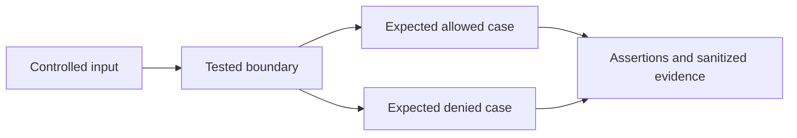

# Kubernetes admission, network, and image-policy lab

**Evidence status:** partially tested lab. Native Kyverno v1.18.2 testing exercised the hardened-pod policy. The image policy is a schema-validated example; signature, certificate, registry, transparency, mutation, and live admission were not tested.

This lab validates a narrow Kubernetes security baseline with positive and negative fixtures. It does not claim that a namespace, admission policy, or NetworkPolicy is a hard hostile-tenant boundary.

## Pinned validation scope

- Kubernetes API shapes reviewed for Kubernetes `1.34`.
- Kyverno CLI `1.18.2`.
- Kyverno `policies.kyverno.io/v1` `ValidatingPolicy` and `ImageValidatingPolicy`, stable in Kyverno 1.18.

Run the dependency-free structural and identity-policy tests:

```text
node labs/kubernetes-security/tests/run-tests.js
```

Run the native Kyverno tests:

```text
kyverno test labs/kubernetes-security --remove-color
```

For a complete copy-and-run setup without an installed CLI, use
`bash labs/kubernetes-security/validate-kyverno.sh`. The script downloads the pinned
1.18.2 platform archive, compares its SHA-256 with the reviewed release checksum,
runs the seven-case suite and removes its temporary binary. It supports Linux and
macOS ARM64/x86-64 and requires Python, curl and tar. This verifies a checksum,
not the release's Sigstore signature. No cluster is contacted or modified.

On 2026-07-23, the official Kyverno v1.18.2 Windows CLI asset (SHA-256 `b5c9d1cb75587a312dc8334537a5773bdedb1a985deae9d89a5251385afb831f`) ran the native hardened-pod suite: `7 tests passed and 0 tests failed`. This native run does not include `verify-release-images.yaml`.

## Enforcement demonstrated

`policies/hardened-pods.yaml` denies:

- privileged containers and privilege escalation;
- host PID, IPC, or network namespaces;
- `hostPath` volumes;
- added Linux capabilities or failure to drop `ALL`;
- writable root filesystems;
- missing non-root and seccomp configuration;
- missing CPU/memory requests or limits; and
- service-account token automount unless explicitly disabled.

The accepted Pod is tested alongside privileged, host-namespace, `hostPath`, capability, missing-resource, and token-automount negative fixtures.

`policies/verify-release-images.yaml` uses the stable Kyverno 1.18 `policies.kyverno.io/v1` `ImageValidatingPolicy`. It constrains repository, keyless issuer, full workflow-and-branch subject, SLSA provenance predicate type, required verification, digest verification, and `failurePolicy: Fail`. Separate `:*` and `@sha256:*` globs make tagged and digest references to the exact repository eligible for evaluation while excluding lookalike repositories.

On 2026-07-23, the manifest conformed to Kyverno v1.18.2's official `ImageValidatingPolicy` CRD v1 schema. The downloaded CRD asset SHA-256 was `3528151f3717c9946ee56d60866f2cf6c29a4b1a7e759c72af60451147b995c2`. The Node harness separately evaluates eleven synthetic, already-resolved evidence claim sets. It returns false for unsigned, wrong repository/workflow/branch/issuer/predicate, missing or malformed provenance, verifier/transparency failure, and digest mismatch.

The twelfth case proves only that a tag such as `:latest` matches the reviewed tag selector. Its admission result is deliberately `null`: the harness does not model registry resolution or Kyverno's `mutateDigest` behavior and therefore makes no accept/deny claim for tag-only input. This is a **schema-validated example; no live enforcement test**. Signature, certificate, registry, transparency-log, mutation, webhook failure, and controller behavior were not executed.

## Network boundary

`fixtures/network-policies.yaml` contains namespace-wide default-deny ingress and egress plus an explicit DNS exception. NetworkPolicy has an effect only when the selected CNI implements it. DNS labels, ports, node-local DNS paths, dual-stack behavior, and required application egress must be verified in each cluster. NetworkPolicy does not control all host-network, node, service-mesh, or cloud-network paths.

## Operational rollout

Use `observe → audit → warn → enforce → measure bypasses`. Track policy evaluation errors, denials, exceptions and expiry, unsigned-image attempts, registry/rekor availability, admission latency, and workloads that require a separate runtime class or cluster. Keep a reviewed break-glass path outside tenant administrator control.

## Reproducibility and threat-model audit — 2026-11-02

| Element | Bounded experiment |
| --- | --- |
| Actor | Tenant controlling workload spec or image evidence |
| Assets | node isolation, service account and verified image decisions |
| Entry points | pod manifest, image reference and network policy |
| Boundary | Fixture input → native admission policy or local image model → expected result |
| Safety | Owned synthetic fixtures; no production data or cloud credentials; no cloud deployment |



### Complete local setup

Use a fresh repository checkout and the prerequisites above. From repository root:

```sh
npm ci --ignore-scripts
node labs/kubernetes-security/tests/run-tests.js
kyverno test labs/kubernetes-security --remove-color
```

Native policy testing needs Kyverno CLI 1.18.2; the dependency-free structural check can run without it. The complete policy and pod/network manifests are tracked beside this README. No existing cluster is used or modified.

This is a local decision experiment, so the complete implementation is its tracked code, fixtures and policy files. It needs no Terraform deployment, service account or publicly exposed server. Never relocate fixture workflows into an active CI directory without a separate environment review.

### Evidence, expected output and interpretation

The documented command exits zero only when its assertions pass; an unexpected
allow/deny, schema or state result is a failure. Preserve the full command output
under ignored `.artifacts/research/` with runtime/tool versions and exit status.
Use the specific expected markers above rather than inventing example output.
The [lab audit](../../research-methodology/lab-audit.md) records the validation run.

Native CLI pod-policy tests do not prove live cluster admission, signature verification, image mutation or CNI packet enforcement. Local finite-case coverage is not a production false-positive or
false-negative estimate. TTD/TTC, representative pipeline overhead and monthly
cloud cost are **not measured in this lab**.

### Teardown and resources

The processes exit and remove their temporary test files. There is no cloud destroy command. Retained evidence, optional provider downloads and local Docker image cache are your only persistent outputs; remove them after review. Node dependencies can remain for subsequent runs.

Local CPU, memory, dependency downloads and optional image disk space are the resource cost. There is no measured cloud bill. Related research links above define which claims the experiment supports.

## References

- [Kyverno v1.18.2 release and official CRD/CLI assets](https://github.com/kyverno/kyverno/releases/tag/v1.18.2)
- [Kyverno policy type lifecycle](https://kyverno.io/docs/policy-types/overview/)
- [Kyverno ImageValidatingPolicy](https://kyverno.io/docs/policy-types/image-validating-policy/)
- [Kubernetes Pod Security Standards](https://kubernetes.io/docs/concepts/security/pod-security-standards/)
- [Kubernetes ValidatingAdmissionPolicy](https://kubernetes.io/docs/reference/access-authn-authz/validating-admission-policy/)
- [Kubernetes NetworkPolicy](https://kubernetes.io/docs/concepts/services-networking/network-policies/)
- [Kubernetes service-account token projection](https://kubernetes.io/docs/tasks/configure-pod-container/configure-service-account/)

## Related maintained investigations

- [kubernetes multi tenancy](../../cloud-security/kubernetes-multi-tenancy.md)
- [evidence driven host analysis](../../linux-security/evidence-driven-host-analysis.md)
