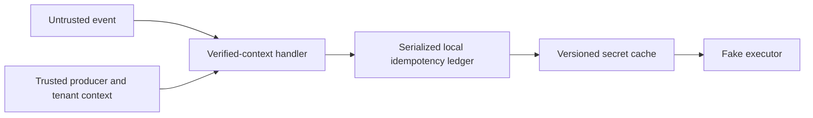

# Event context and secret-cache lifetime lab

**Tested teaching model.** This is not a Lambda, event-source, Vault or Secrets
Manager implementation. Context authentication is injected, not cryptographically
verified. No cloud resource or real secret exists.

## Objective and threat model

An event sender controls IDs, tenant and payload. The model trusts a separately
verified producer context, derives execution tenant from it, and rejects stale,
foreign or schema-invalid input. A duplicate must not repeat a simulated side
effect. A long-lived process must not reuse another request's tenant context.



## Prerequisites, setup and validation

Node.js 22+; no package install, container, network, credential or cloud account.
From repository root:

```sh
node --test labs/request-lifecycle/lifecycle.test.js
```

Expected: six passing methods. Negative producer/tenant/schema/time cases assert
zero executor calls; the concurrent duplicate case asserts one call; warm reuse
asserts separate tenants. Cache tests inject a clock: old version at 999 ms, new
version at 1000 ms, refresh failure after expiry rejects without a stale fallback.
This measures the model's exact timer contract, not provider rotation latency.

## Evidence, cost and teardown

```sh
mkdir -p .artifacts/research
node --test labs/request-lifecycle/lifecycle.test.js > .artifacts/research/lifecycle.tap
```

The process exits and all memory state disappears. Delete the evidence after review.
There is no service, persistent state, infrastructure, cloud cost or destroy step.
CPU/memory are small local test-process costs; production overhead is not measured.

## Failure modes and limitations

The ledger intentionally retains event data in memory to compare payload reuse;
it has no retention cap, durable transaction or distributed reconciliation. A
failure after an external side effect but before ledger completion could duplicate
work. Do not treat this serialization as production exactly-once execution. Secret
material remains in process memory; the cache cannot revoke already issued values
or existing downstream sessions. A real provider, queue and storage system need
separate tests and lifecycle controls. Audit is memory-only and omits error events
when the secret provider throws; detection coverage for that path is incomplete.

## Related research and references

- [Serverless event trust and reuse](../../cloud-security/serverless-security.md)
- [Secrets delivery and revocation](../../devsecops/secrets-management.md)
- [Evidence standards](../../research-methodology/evidence-standards.md)

## Related maintained investigations

- [serverless security](../../cloud-security/serverless-security.md)
- [secrets management](../../devsecops/secrets-management.md)
