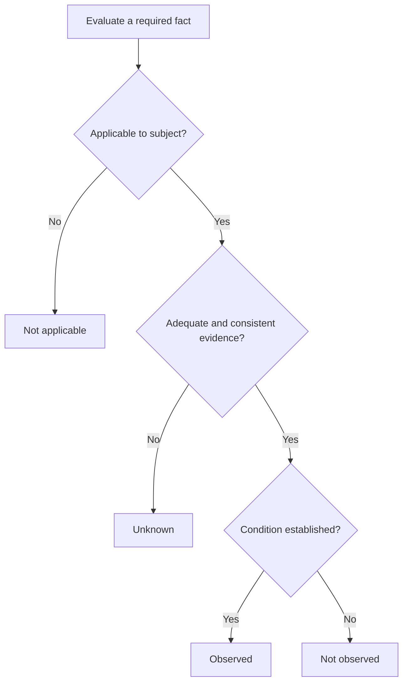
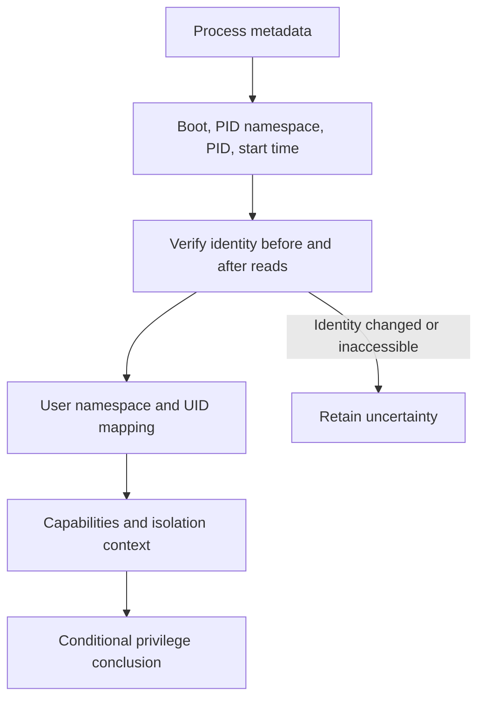
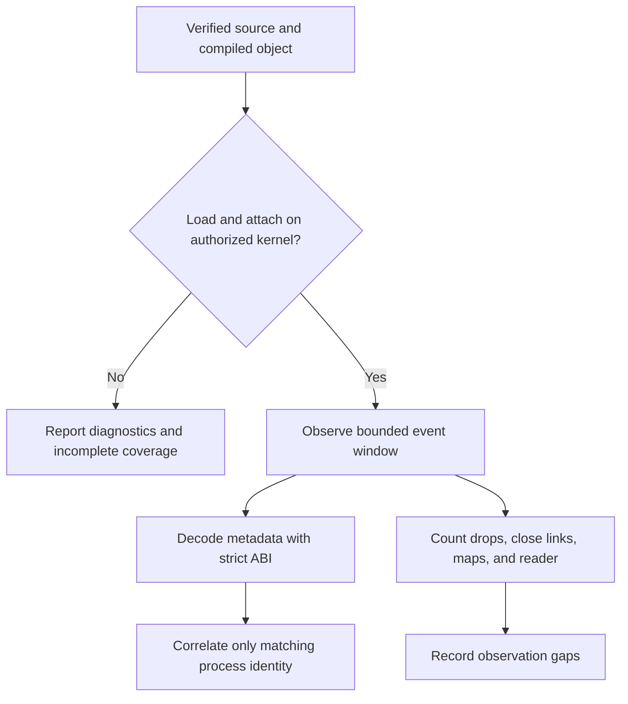

# Linux Host Analysis Without Invented Attack Paths

Linux host analysis becomes misleading when a scanner equates UID 0 with host root,
a wildcard listener with Internet exposure, or a disappeared finding with a resolved
risk. The research supports a more conservative design: record the evidence, retain
its namespace and collection context, and state what remains unknown.

This article synthesizes source and design-document inspection. It does not report
new privileged host tests, confirmed exploitation, production incidents, or a working
kernel sensor. All diagrams and implementation guidance are **illustrative**.

## Decision: preserve four evidence states

Keep `observed`, `not observed`, `unknown`, and `not applicable` distinct. A permission
error or truncated read must not become a negative finding. Record scope, collector,
time, evidence references, diagnostics, and collection completeness alongside results.

Coverage counters describe inspected work, not the percentage of all vulnerabilities
that a host contains. A process status read can succeed while descriptor inspection
fails; those outcomes need separate counters. A rule requiring an unknown fact
cannot produce a confirmed match.

## Identity must survive PID reuse and namespaces

A PID alone is not durable process identity. Bind evidence to boot identity, PID
namespace, numeric PID, and start time; verify identity around dependent reads. A
process can still exec or change descriptors during collection, so this does not make
the whole-host snapshot atomic.

UID 0 inside a user namespace does not by itself establish host-root authority.
Privilege interpretation needs user-namespace identity and mappings. Capabilities
are also evaluated in namespace context, and LSM, seccomp, mount policy, and object
permissions can constrain their consequences. See the Linux manual pages on
[user namespaces](https://man7.org/linux/man-pages/man7/user_namespaces.7.html) and
[capabilities](https://man7.org/linux/man-pages/man7/capabilities.7.html).

Do not join a runtime event to a static process merely because its command name or
PID matches. Missing start identity should leave an event unlinked rather than attach
it to a plausible neighbor.

## Exposure and exploitability are different questions

A non-loopback listener establishes potential reachability in its network context.
It does not establish a route through upstream firewalls, NAT, cloud controls, or a
public load balancer. IPv6 wildcard binding does not independently prove IPv4
acceptance. A familiar port number is a hint about service purpose, not a verified
protocol fingerprint.

Report severity, confidence, and exposure separately. A severe consequence with
incomplete reachability evidence should remain severe and uncertain, rather than
being converted into a fabricated probability of compromise.

Permission bits can similarly identify a write candidate without proving effective
access. Supplementary groups, ACLs, UID mappings, sticky directories, mount flags,
and LSM policy matter. Do not emit an unconditional `CAN_WRITE` relationship when
only mode bits were inspected. A path resembling a host mount is not sufficient
proof of source ownership.

## Safe collection is part of the scanner boundary

Procfs strings, filenames, rule files, and saved reports are untrusted input. Bound
reads and worker counts, reject malformed fields, escape terminal control characters,
and render HTML as text. Avoid collecting full arguments, environment variables,
private-key contents, or network payloads merely to enrich a graph.

For filesystem metadata, use pinned object identity and directory-relative path
resolution. The [openat2 interface](https://man7.org/linux/man-pages/man2/openat2.2.html)
provides resolution controls; the exact flags must match the intended scope and
symlink policy. A path string checked earlier is insufficient protection against a
later replacement or overmount. Secure report writing also needs a trusted directory,
no-follow behavior, private permissions, and atomic replacement.

A read-only scanner can still expose secrets in reports or exhaust host resources.
Apply input-size, process-count, traversal-depth, filesystem-root, and time budgets;
record truncation rather than claiming complete inspection. A compromised kernel
can falsify the very metadata being collected, so this approach does not establish
integrity against a hostile kernel or privileged actor.

## Optional eBPF evidence has a separate readiness gate

Compiling a CO-RE object does not prove verifier acceptance, attachment, or real event
delivery. Required capabilities, usable BTF, tracepoints, kernel policy, architecture,
and cleanup must be checked on authorized representative machines. Do not recommend
broad administrative capability as a universal workaround.

A connect or bind entry event is an attempt; it may fail. A successful accept syscall
is a different fact, and none independently proves Internet exposure. Bounded ring
buffers and retained-event limits prevent unbounded growth, but dropped events reduce
coverage. Zero retained events means no retained observation during that window,
not absence of activity. Repeated windows have gaps and should not be advertised as
continuous coverage. The [kernel BPF documentation](https://docs.kernel.org/bpf/)
is the primary reference for platform-specific behavior.

## Drift must require negative evidence

Mark a prior finding resolved only when a compatible new scan has complete relevant
coverage and an explicit negative or not-applicable evaluation for the same stable
subject. If a process disappears, collection is denied, or scan scope changes, retain
an unknown outcome. Stable fingerprints help continuity but cannot erase meaningful
changes in host identity, service identity, or rule semantics.

Suppressions should preserve findings and evidence, record a justification, and have
a review or expiry policy. A suppression is a policy decision, not remediation.

## Validation and limitations

Test positive, negative, missing, conflicting, unknown, and not-applicable inputs for
each rule. Exercise PID reuse, inaccessible procfs, malicious paths, symlink races,
namespace ambiguity, report escaping, event loss, and changed scan scope. Privileged
runtime tests belong on isolated authorized VMs; this article ran none of them.

The reviewed design deliberately stops short of exploit execution, enforcement,
whole-enterprise lateral movement, and universal effective-access modeling. Those
limits are essential to interpreting its output accurately.

## References

- [Linux user namespaces](https://man7.org/linux/man-pages/man7/user_namespaces.7.html)
- [Linux capabilities](https://man7.org/linux/man-pages/man7/capabilities.7.html)
- [openat2 path resolution](https://man7.org/linux/man-pages/man2/openat2.2.html)
- [Linux kernel BPF documentation](https://docs.kernel.org/bpf/)
