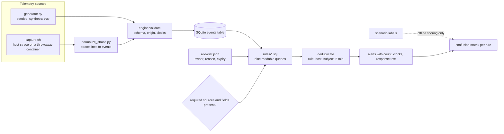
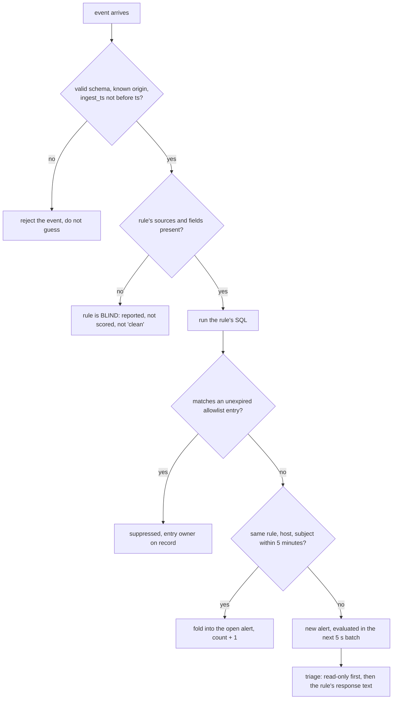

# Host Telemetry Detection Lab: Nine Linux Rules, Their False Positives, and What They Cannot See

This is a study of detection **logic**, not of a sensor. Nine rules turn host events (process starts, file reads and writes,
permission changes, outbound connections) into alerts. The interesting questions are the ones a rule's author usually skips: what
legitimate activity does it also flag, what malicious activity does it miss, who owns each exception, and what does it say when its
data source is gone?

> **Synthetic data, stated plainly.** Every event produced by the generator carries `"synthetic": true` and `"origin": "synthetic-generator"`.
> Nothing here records, simulates or reproduces a real intrusion; there is no malicious code in the lab. The one dataset with
> `"origin": "strace-capture"` is real kernel-observed syscalls from harmless placeholders inside a throwaway container. The corpus was
> written by the rule author, so its numbers describe the rules' logic, not field accuracy.

Evidence labels: `tested locally` (executed here; output in the lab's [`evidence/`](https://github.com/jasonachkar/cybersecurity-writeups/tree/main/labs/linux-host-telemetry/evidence)),
`policy model` (a rule evaluated by a local test, not by a production sensor), `source-reviewed` (read in the named primary source),
`requires-review` (no independent reviewer yet). They map to T2/T3, T1, T0 and review status in the
[evidence standards](../research-methodology/evidence-standards.md). This article builds on, and does not repeat, the process-identity
argument in [Linux Host Analysis Without Invented Attack Paths](evidence-driven-host-analysis.md).

## Scope

In scope: the behaviours below, expressed as queries over normalized events; their false positives and misses; exception ownership; missing-telemetry
reporting; deduplication; and a cross-check of the same rules on real kernel-observed syscalls. Out of scope: fleet-scale collection, kernel sensors
(auditd, eBPF, Falco, Tetragon, osquery), a SIEM, enrichment, and response automation. Response guidance is written for people and was never executed.

## What I built

The code lives in the [linux-host-telemetry lab](../labs/linux-host-telemetry/README.md). The shape:



The labels reach the scorer only; a test asserts that no rule's SQL mentions `scenario`, `synthetic` or `origin`, so a rule cannot read the answer key.

Process ancestry, the one place SQL needs care, is a recursive query keyed on process **identity** (host, boot, pid, start time), not on pid:



*Status: `tested locally`; every box maps to a function in `engine.py` and at least one test.*

### The rules

Each rule is one SQL file whose header states severity, required telemetry and response guidance. Scenario counts are from the pinned table below.

| Rule | Looks for | Why it is high-signal | Known false-positive sources |
| --- | --- | --- | --- |
| LNX-001 | A shell or interpreter whose ancestor within 3 levels is a network-facing service | Services rarely need a shell; the ancestry catches a helper in between | App code that shells out (`git`, image conversion); supervisors |
| LNX-002 | A write under `/etc/cron.d`, `/etc/cron.*`, `/etc/crontab` by a non-package-manager | System cron is mostly managed by packages and configuration management | Manual edits; config-management tools not allowlisted |
| LNX-003 | A systemd unit written by a non-package-manager whose `ExecStart` is under `/tmp`, `/dev/shm`, `/var/tmp`, `/home` or `/root` | A service pointing at a writable directory is persistence-shaped | Developer user units under `/home` |
| LNX-004 | A process executing from `/tmp`, `/var/tmp` or `/dev/shm` connecting to a **public** address | Legitimate services do not run from world-writable directories | CI tooling unpacked in `/tmp` |
| LNX-005 | A read of `/etc/shadow`, SSH host/user keys, cloud credentials by anything but the designed readers | Few programs have a reason to read these | Backup agents, audit scanners |
| LNX-006 | A write to sudoers, `passwd`/`shadow`/`group`, PAM, `sshd_config`, `ld.so.preload` by anything but the designed tools | Direct changes to authorization are rare and consequential | Approved manual changes (`tee`, editors) |
| LNX-007 | `chmod` setting setuid/setgid on a **file** by a non-package-manager | New setuid binaries are a classic local-escalation precondition | None observed; directories are excluded on purpose |
| LNX-008 | Execution from `/memfd:…`, `/proc/self/fd/…`, or a path ending `(deleted)` | A process with no file on disk is unusual | A binary replaced mid-upgrade (rare) |
| LNX-009 | Truncating or deleting under `/var/log` by a non-rotation tool, or `auditctl -e 0` | Removing evidence is rarely routine | Emergency disk clean-ups |

Design decisions worth defending:

1. **SQL, not a DSL.** A reviewer can read the query that fired. The cost is that SQL cannot express "this process, then that one within 60 seconds" cleanly;
   LNX-001 needs a recursive CTE, and anything with ordered sequences would need a second engine.
2. **Exceptions are data with an owner and an expiry.** The engine refuses an allowlist entry missing either, and ignores an entry after its date. Exercised: the
   backup agent (S43) is suppressed; the legacy sync tool (S45), whose exception expired 2026-06-30, alerts again with the same behaviour.
3. **Package-manager and designed-tool exclusions live in the rule, not the allowlist.** They are part of what the rule means; environment-specific exceptions are not.
4. **Path-based egress (LNX-004) is a deliberate simplification.** It is cheap and quiet, and it misses a reverse connection from a system `bash` (S34). A
   behavioural version needs socket-to-stdio correlation that this telemetry model does not carry.

## Research question and hypothesis

**Question:** Can a small set of SQL host rules separate designed behaviour from suspicious behaviour on labeled telemetry while reporting a missing sensor or field as blind rather than clean?

**Falsifiable hypothesis (bounded experiment):** Every scenario's outcome matches its documented expectation, including seven named residual false positives and two named misses; background activity produces no alerts; a rule whose source or field is absent is reported blind and excluded from scoring. Any silent change in the confusion matrix, an alert on background noise, or a missing-source rule scored as a true negative refutes it.

## Research threat model

| Element | Declared scope |
| --- | --- |
| Actor | A local process on a Linux host with the privileges of a web service account or an interactive session, trying persistence, credential access, privilege change or log removal |
| Assets | The host's authentication and authorization files, cron and systemd persistence points, credential files, and the audit trail |
| Entry points | Process starts, file writes/reads/chmods/truncates, outbound connections as seen by an assumed sensor |
| Trust boundaries | Kernel events → sensor → normalization → rule → alert → human; the rules assume the sensor reports faithfully |
| Impact under investigation | A rule that alerts on everything, nothing, or only on what its author expected, and a telemetry gap that looks like a quiet host |
| Trusted assumptions | The sensor delivers accurate `exe`, path and process-identity fields; the host kernel is not compromised; an attacker who knows these rules is **out of scope** (two evasions are shown, not a bypass analysis) |

## Method and evidence requirements

Follow the [evidence standards](../research-methodology/evidence-standards.md) (Detection row: labeled fixtures, parser and query, TP/FP/FN/TN counts, a missing-source
case, event/ingest/alert clocks, deduplication and response limits). The [lab](../labs/linux-host-telemetry/README.md) owns setup, prerequisites, expected output, safety,
evidence collection and teardown. From repository root:

```bash
python3 labs/linux-host-telemetry/tests/test_detections.py
```

This command is a **tested local check** of detection logic, with the scope below. The full run (`bash labs/linux-host-telemetry/scripts/run-lab.sh`) additionally
generates the corpus, scores it, removes the network sensor, and, where Docker and `strace` exist, captures real syscalls. A passing run does not show that the rules work on a
real fleet; it shows that they do what this article says on the data it describes.

## Validation

Recorded run, 2026-11-05 (`evidence/versions.txt`): Python 3.13.18, SQLite 3.53.1, Linux 6.18.44, strace 6.8, Docker 29.9.2. All `tested locally`.

| Command | Observed |
| --- | --- |
| `python3 labs/linux-host-telemetry/tests/test_detections.py` | `Ran 23 tests ... OK` |
| `bash labs/linux-host-telemetry/scripts/run-lab.sh --publish-evidence` | 9 assertions passed, 0 failed |
| generator | `855 synthetic events, 42 labeled scenarios (seed 20261105)`; byte-identical on a second run |
| engine over the corpus | 27 deduplicated alerts; **0 alerts on 400 iterations of background noise** |
| engine, network sensor removed (`--sources exec,file`) | LNX-004 `blind` (missing source `net`), no LNX-004 alert, no LNX-004 score |
| capture | 176 strace lines, 28 normalized events |
| engine over the capture | alerts from exactly LNX-002, 005, 006, 007, 009; LNX-004 silent; LNX-003 `blind` (missing field `exec_start`) |

## Findings and interpretation

### Scenario-level results on the synthetic corpus

42 scenarios: 17 malicious-pattern, 17 benign look-alike, 6 control, 2 evasion. Counted per rule per scenario; totals over the nine rules are TP 19, FP 7, FN 2, TN 216.

| Rule | TP | FP | FN | TN | Precision | Recall |
| --- | --- | --- | --- | --- | --- | --- |
| LNX-001 | 4 | 1 | 0 | 24 | 0.80 | 1.00 |
| LNX-002 | 2 | 1 | 1 | 23 | 0.67 | 0.67 |
| LNX-003 | 1 | 1 | 0 | 24 | 0.50 | 1.00 |
| LNX-004 | 2 | 1 | 1 | 23 | 0.67 | 0.67 |
| LNX-005 | 3 | 1 | 0 | 24 | 0.75 | 1.00 |
| LNX-006 | 3 | 1 | 0 | 24 | 0.75 | 1.00 |
| LNX-007 | 1 | 0 | 0 | 25 | 1.00 | 1.00 |
| LNX-008 | 2 | 0 | 0 | 25 | 1.00 | 1.00 |
| LNX-009 | 1 | 1 | 0 | 24 | 0.50 | 1.00 |

These are a **regression guard and a statement of documented behaviour**, not a population estimate: the author wrote both the rules and the corpus, small per-rule denominators
make the ratios unstable, and the 216 true negatives are mostly scenarios that have nothing to do with a given rule. The table is pinned in the tests so a change is a deliberate edit.

| Claim class | Evidence tier and boundary |
| --- | --- |
| Rule logic does what the SQL says on labeled input | T2/T3, `tested locally`, 23 tests over the synthetic corpus |
| The seven look-alikes alert and the two evasions stay silent, as documented | T3, pinned confusion matrix |
| Real kernel events reach the same rules through a normalizer | T2, one capture, five rules positive, one negative, one blind |
| Time to detect, field false-positive rate, adversary resistance | Not established; synthetic latency only |
| A rule's recommended response is right for your environment | T0 judgment; never executed here |

### Residual false positives, and what resolves each

The seven benign look-alikes that alert are the point of the exercise. Each needs context the telemetry does not carry:

| Scenario | Rule | Why it alerts | What resolves it | Owner action |
| --- | --- | --- | --- | --- |
| S04 gunicorn runs `git rev-parse HEAD` | LNX-001 | Real service, real shell | The exact command and parent are known | Allowlist `parent_exe` + command regex with an owner and expiry, or have the app read its version at build time |
| S13 `vim` edits `/etc/cron.d/backup` | LNX-002 | A manual change by a human | A change record | Ask; prefer configuration management as the only writer |
| S23 developer user unit under `/home` | LNX-003 | `/home` is in the writable set | Host role (developer workstation vs server) | Scope the rule to server roles |
| S33 CI toolchain in `/tmp` connects out | LNX-004 | Executes from a writable directory | The binary's hash or a dedicated build directory | Run builds elsewhere; allow by hash, never by path |
| S44 nightly audit scanner reads `/etc/shadow` | LNX-005 | Designed reader not on the list | Inventory of scanners | Allowlist with owner and expiry |
| S54 `tee /etc/sudoers.d/dev-team`, approved | LNX-006 | Legitimate, approved write | The approval | Attach a change reference; do not allowlist `tee` |
| S82 `truncate -s 0 /var/log/syslog` | LNX-009 | Emergency clean-up | Asking the person; confirming the shipper holds the data | Respond by asking, not by isolating |

Ten other look-alikes (S03, S11, S12, S21, S22, S43, S52, S53, S61, S62) are correctly quiet: three because of an unexpired exception, the rest because the rule
excludes the designed tool or the specific shape (for example S62: setgid on a **directory**).

### What the lab found that I did not plan for

1. **Deduplication can hide a distinct action.** The key `(rule, host, subject)` with a 5-minute window folds any second hit with the same subject into the first alert's count. When I tested
   a pid-only ancestry join, the benign S06 hit was folded into S01's alert (subject `nginx > sh`), so my first scorer attributed the alert only to S01 and S06 looked silent. The scorer now
   tracks the folded scenarios (evaluation-only metadata; a real pipeline sees only the count). The production lesson: choose the key deliberately. A coarse key reduces noise and
   also means a second, different shell started by the same service inside the window is not a second alert.
2. **Python's `ipaddress.is_private` is true for the RFC 5737 documentation ranges** the lab uses as stand-ins for "somewhere on the Internet". The first normalizer classified them as private and a
   test caught it. Classification now treats only loopback, RFC 1918, link-local and ULA as internal.
3. **A source can be present while a needed field is not.** The first engine reported LNX-003 as evaluated on the strace capture, although strace can never provide a unit's parsed `ExecStart`. Coverage is
   now checked per source **and** per field: LNX-003 is `blind` on the capture. A silent rule and a blind rule look identical in an alert list; they must not be treated alike.
4. **PID reuse is a real attribution risk, and identity prevents it.** In S06 a benign shell reuses the pid of a former nginx child. The identity-aware ancestry (pid **and** start time, the latter being
   `/proc/[pid]/stat` field 22, `source-reviewed`) attributes it correctly; the same query with the start-time condition removed alerts on it. Both outcomes are asserted.
5. **Ingestion lag, not rule logic, dominates detection time.** Synthetic latency was a median of 3.6 s, but S91, whose events reach the pipeline 125 s late, alerts after 125-127 s. These are synthetic
   clocks (a 5 s evaluation batch plus a generated lag), not a measurement of any real pipeline.

### The real-kernel cross-check

`capture.sh` runs a busybox container whose script performs harmless analogs: a comment-only file in `/etc/cron.d`, a read of the container's own `/etc/shadow`, a comment-only
`sudoers.d` drop-in, `chmod 4755` on a copy of `/bin/true`, a truncated log file, and a connection from a copy of `wget` in `/tmp` to a **private** canary. The host attaches `strace -f` to the container's PID 1.
176 raw lines became 28 events and exactly the five matching rules alerted. LNX-004's negative control (a `/tmp` executable talking to a private address) stayed silent.

Two caveats are part of the finding. The first-attached process has no `execve` in the trace, so its `exe` comes from `/proc/<pid>/exe` at attach time. And `strace` is a capture convenience: it
perturbs timing, records only the syscalls it is asked for, and supplies host PIDs without start times (the normalizer substitutes a per-trace ordinal, which keeps identity within one capture but is not a kernel start time).

## Practical guidance and failure containment

- **Treat blind as an incident in the pipeline.** A rule whose source or field is gone should page the telemetry owner, because its silence is not evidence of a clean host.
- **Exceptions need an owner and an expiry, and the engine should enforce both.** An exception without an expiry is a permanent hole nobody remembers granting.
- **Respond read-only first.** Every rule's response text starts with capture and attribution; containment follows evidence. LNX-008 in particular: the deleted or in-memory file is only recoverable while the process lives.
- **Never auto-isolate a host on a single rule.** Seven of nine rules have a documented legitimate source; automation without the context that resolves it turns a false positive into an outage.
- **Roll back by disabling the rule or its exception, not by loosening the pattern.** Rules are files; the previous version is in version control.

Failure containment: a bad rule is bounded by its blast radius, an alert (a person reads it), not by an action. The first automated action added to any rule should be reversible and rate-limited, and I did not build one.

## What was not tested

- **Production sensors** (auditd, eBPF, Falco, Tetragon, osquery) and their fidelity, drops, and overhead. `strace` is not a representative sensor.
- **Real fleet data.** False-positive rates here are properties of a hand-written corpus. A real environment will have more sources of both noise and evasion.
- **Rules LNX-001, 003, 004 and 008 on real kernel data.** The capture exercises 002, 005, 006, 007, 009 and one negative for 004; the rest are tested on synthetic events only.
- **A knowing adversary.** Evasion is two hand-written cases (a per-user crontab, an outbound connection from system `bash`). There is no bypass analysis.
- **Time to detect and time to contain** against a real pipeline; the latency in this lab is synthetic.
- **Response actions.** They are written guidance and were never executed.
- **Container and Kubernetes context** (namespaces, cgroups, image provenance as fields) and multi-host correlation.

## Production considerations

**Rollout.** Run every rule report-only on a few hosts of each role (web, build, bastion, workstation) for at least one full change cycle. Record each alert's disposition; the
list of dispositions is the first draft of the allowlist and tells you which rules need a host-role scope (LNX-003 and LNX-004 almost certainly do). Promote a rule to paging only when its
residual false-positive sources are known and owned.

**Detection.** Alert on pipeline health as seriously as on the rules: a falling event rate per host, a rule reported blind, an allowlist entry about to expire, and a rule that has not fired
in a long time all deserve a signal. Log the rule version, the allowlist version and the evaluation batch on every alert so a disposition can be reproduced.

**Operability.** Keep rules in version control as plain files and review them like code, including the exclusions. Give each exception a named owner and an expiry date and
notify the owner before the date. Choose the deduplication key per rule, not globally, and state the window in the alert so an analyst knows a count of 50 means 50 hits.

**False positives.** Expect the seven families above plus whatever your environment adds (CI runners, backup and EDR agents, developer tooling, configuration management). Resolve each by
adding context to the rule (host role, a change reference, a binary hash), not by widening exclusions. Never allowlist a generic tool such as `tee`, `sh` or `python3`.

**Blast radius.** A detection rule's worst case is an unnecessary investigation or, with automation, an unnecessary isolation. Keep the response step manual until the rule's
disposition history justifies otherwise, and make any automated step reversible.

**Rollback.** Disable the rule file or the exception; both are one-line changes and both leave the history intact. Keep the corpus in the repository and re-run the tests when a rule changes so a fix for one false positive
cannot silently open a new miss.

## Limitations and what was not tested

The local experiment validates detection **logic** on a corpus its author wrote and on one small real capture. It does not validate the complete reference architecture, a production sensor,
live cloud enforcement, hosted CI, representative adversarial coverage, or independent audit storage. Review status remains `requires-review` until a reviewer checks the claims above against
`validatedAgainst` and the linked evidence.

Time to detect, time to contain, population false-positive and false-negative rates, pipeline overhead and cost are **not measured in this article**. Use the
[measurement contract](../research-methodology/evidence-standards.md#measurement-contract) to define clocks, denominators, repeated workloads and residual capabilities before claiming those outcomes.
Report local fixture counts separately from live coverage.

## Open questions

Which fields must a production sensor attach to a file event (parsed `ExecStart`, writer's session and tty, package ownership of the path) for LNX-003 and LNX-006 to drop their residual false
positives without allowlisting tools, and how much does enriching events at the sensor cost compared with enriching them at query time?

## References

- Linux man-pages, [proc(5)](https://github.com/mkerrisk/man-pages/blob/master/man5/proc.5): `/proc/[pid]/stat` field 22, `starttime`, the time the process started after system boot (the basis for pairing a start time with a pid).
- strace project, [strace(1)](https://github.com/strace/strace/blob/master/doc/strace.1.in): the trace-line format the normalizer parses (name, arguments, return value, `errno` on failure, octal modes).
- The documentation-only address ranges used for destinations (192.0.2.0/24, 198.51.100.0/24, 203.0.113.0/24) are those of RFC 5737; the RFC text was not reachable from the build environment and is named from memory, not listed as consulted.
- [Linux Host Analysis Without Invented Attack Paths](evidence-driven-host-analysis.md), the maintained process-identity argument this lab builds on.
- [Linux host telemetry detection lab](../labs/linux-host-telemetry/README.md), the implementation, tests and evidence.
