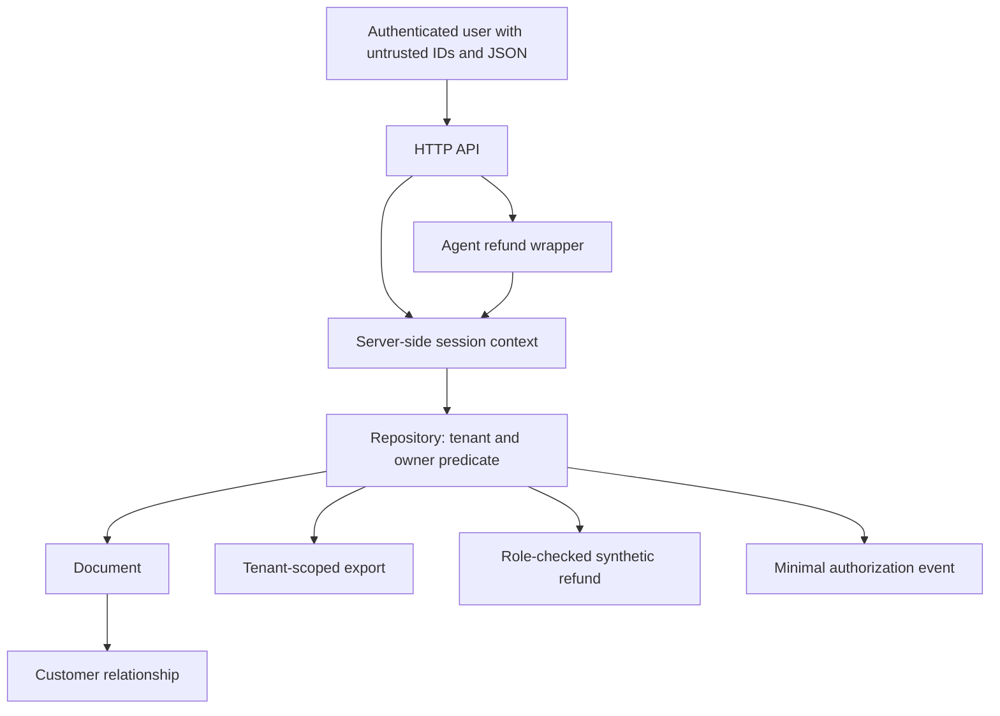

# Multi-tenant BOLA: One Authorization Predicate Across Every Data Path


## Executive summary

**Observed, T4:** an authenticated synthetic user can read, change and delete a
foreign tenant's document through the vulnerable API. Export trusts a client tenant
header, and an agent wrapper replaces the caller with the target object's owner.
The remediated API rejects the tested foreign-object operations, preserves state
on denials, scopes export to the session, and permits the user's intended work.

This is an owned teaching API. It is not a finding against a named SaaS platform.
[OWASP API1:2023](https://api-security.owasp.org/editions/2023/en/0xa1-broken-object-level-authorization/)
provides the class context: authentication alone does not establish object-level
authority (T0). The [lab](lab/README.md) provides behavioral evidence separately.

## Research question and hypothesis

Does a common data-access predicate prevent tenant and owner confusion across
read, update, delete, export, sensitive action and agent-invocation paths?

**Hypothesis:** deriving tenant/user from a valid server session and applying
`row.tenant == actor.tenant AND row.owner == actor.user` at the repository boundary,
plus operation-specific role and field checks, rejects the enumerated misuse
without breaking the five positive cases. Any unauthorized disclosure or mutation
in the remediated corpus refutes this hypothesis.

## Threat model

| Element | Scope |
| --- | --- |
| Assets | Synthetic tenants, users, customer links, documents and refund records |
| Actor | Alice has her own valid session; knows synthetic document IDs; controls method, path, JSON fields and `X-Tenant-ID` |
| Entry points | `/documents/{id}`, `/documents/{id}/refund`, `/export`, `/agent/refund` |
| Boundaries | Cookie → server session; session → data-access context; object → customer; user → agent wrapper; permitted fields → stored row |
| Trusted | Session map, seed state, server process and code; no client-supplied tenant authority |
| Impact tested | Foreign read/update/delete, selected-field reassignment, foreign export and recorded refund |
| Out of scope | Login, stolen-session defense, payment processor, SQL, real model behavior and administrative compromise |



## Affected component and vulnerability class

[api.py](lab/api.py) contains two repository paths over the same seed model.
The vulnerable `object` lookup uses only an ID. Update binds arbitrary fields,
export accepts a tenant header, and the agent uses object-owner authority. Those
are distinct defects: BOLA, unsafe property assignment, context confusion, and
excessive delegation. They interact but should not be counted as one generic
“authentication failure.”

## Prerequisites and isolation requirements

Python 3.13+ runs the complete suite. Docker Compose additionally runs the same
HTTP tests in a container with **no external network**. Both API servers listen
only on loopback at OS-assigned ports. No secrets, users or JWTs are copied from a
real system. The server generates opaque 256-bit session material at runtime,
stores only its digest, checks expiry and deletes all state when the process exits.

This is session-based authentication, not a JWT implementation. The test bootstrap
creates sessions directly inside the owned process. It does not model user login.

## Method and controlled misuse

Every case starts from fresh state and a generated Alice session. The runner
performs real HTTP requests, checks status and selected returned content, and
independently inspects state. In the secure path every denied matrix call must
leave the entire seed state unchanged. A separate case tests role denial for the
reader Aaron on his own refund action.

**Tested commands**, from the repository root:

```sh
python3 vulnerability-research/api-bola-multi-tenant/lab/test_api.py
docker compose -p research-bola -f vulnerability-research/api-bola-multi-tenant/lab/compose.yaml run --build --rm lab
```

The following sanitized requests omit the generated cookie. `test_api.py` supplies
it from the in-process bootstrap; no placeholder token needs replacing.

| Preconditions and request | Vulnerable observed result | Remediated observed result | Why/fix and residual surface |
| --- | --- | --- | --- |
| Alice `GET /documents/doc-b` | 200, title `SYNTHETIC_B` | 404 `not_found` | Repository now requires tenant and owner; timing enumeration not measured |
| Alice `GET /documents/doc-aaron` (same tenant, different owner) | 200 | 404 | Tenant-only checks would miss horizontal access; this contract additionally requires ownership |
| Alice `PATCH /documents/doc-b` with `{"title":"changed"}` | 200, foreign row changed | 404; state unchanged | Predicate applies before mutation; no asynchronous update path modeled |
| Alice `DELETE /documents/doc-b` | 200, row removed | 404; state unchanged | Same predicate; no backup/restore path tested |
| Alice patches her document with `{"tenant":"tenant-b","owner":"bob"}` | 200, ownership fields changed | 400 `invalid_fields`; state unchanged | Only a bounded `title` update is accepted; schema changes need new tests |
| Alice `GET /export` with `X-Tenant-ID: tenant-b` | 200, only `doc-b` | 200, only `doc-a` | Session scopes data-access export; client header ignored |
| Alice `POST /documents/doc-b/refund` with `{}` | 200, refund record appended | 404; no refund | Authorize object before deriving customer and amount |
| Alice `POST /agent/refund` with `{"document":"doc-b"}` | 200, refund as owner Bob | 404; no refund | Agent retains original caller context; no service-wide authority substitution |
| Alice reads `missing` | 404 | Same status/body as foreign object | Content enumeration reduced; response-time side channels remain unmeasured |

Positive matrix cases are own read, own title update, own delete, own refund and
own agent refund. They return
200 under both configurations. The full matrix has **14 paired cases / 28 HTTP
evaluations**, plus session/role/context checks. This denominator is a finite test
corpus, not a claim about population-wide authorization coverage.

## Evidence ledger

| Claim | Tier | Artifact |
| --- | --- | --- |
| Foreign title is returned by vulnerable read | T4 | `cross-read` response assertion |
| Vulnerable foreign update/delete have actual effects | T4 | Seed state assertions after HTTP calls |
| Secure denied matrix calls do not mutate state | T3/T4 | Whole-state equality and deny audit assertions |
| Export honors server context | T4 | Exact returned-key set in each mode |
| Agent cannot create a foreign refund after fix | T4 | HTTP result and refund-list length |
| Foreign and absent IDs have identical error content | T3 | `test_session_and_enumeration` |
| Tamper-proof audit persistence | Not established | Audit is process memory only |

Observed sanitized secure response:

```json
{"error":"not_found"}
```

The runner's output includes case, mode, status and decision. Audit fields contain
operation, authenticated principal/tenant, outcome and reason; no cookie, document
title or body is retained. The harness scans audit JSON for the session and selected
sentinels. It does not claim exhaustive data-loss prevention.

## Root cause and practical architecture guidance

Identifiers are selectors, not grants. In the vulnerable path the route's successful
session check does not constrain the later lookup. Export and the agent introduce
separate authority sources, so fixing only `GET /documents/{id}` leaves other paths
open. Mass assignment also lets a caller mutate the fields later used as authority.

Put the predicate in the repository so every route consumes the same scoped context.
Reject client updates to tenant, owner, customer and amount. Derive sensitive-action
arguments from the authorized row and verify related customer ownership. Keep
operation grants separate from row visibility. A production SQL repository should
use tenant-scoped queries and independently reviewed RLS where appropriate; the
[PostgreSQL lab](../../labs/postgresql-rls/README.md) exercises that different boundary.

## Business impact and severity reasoning

**Observed:** foreign synthetic content is disclosed and modified, records are
removed, and synthetic refund entries are created. **Likely under additional
assumptions:** comparable defects over customer documents or payment instructions
would affect confidentiality and integrity. No money moves here. There is no
established account takeover, administrator access, or complete system compromise.
Severity is qualitatively high for the lab's tenant-isolation objective because an
ordinary authenticated principal crosses it with one request; this is not a vendor
severity rating or CVSS assessment.

## Remediation, verified fix and regression matrix

The secure path checks valid nonexpired session, tenant and owner, action allowlist,
role for update/delete/refund, closed update schema and document/customer consistency.
Absent or unauthorized objects return the same 404 body. The agent invokes the
same repository as direct requests. Denials emit minimal events.

Mutation assertions distinguish “HTTP denied” from “no side effect.” Fresh per-case
seeding prevents an earlier deletion from turning a later test into an accidental
404 success. Legitimate calls prevent deny-all implementations from passing.
Add every new bulk, job, search, cache and tool endpoint to the matrix before release.

## Detection engineering and compensating controls

The executable [detection predicates](../detection.py) recognize denied object
operations as blocked attempts. A production correlation should group principal,
operation and time window, distinguish missing/stale sessions from object denials,
and compare to baseline support activity. Thresholds are **illustrative** until
representative data exists. Missing-source monitoring needs an independent canary.

Opaque identifiers reduce guessing convenience; they do not authorize access.
Apply request budgets, export quotas, purpose-bound agent grants and independently
protected audit storage. Require a separate approval for high-impact refunds and
reconcile idempotency against downstream state; neither control is implemented in
this toy API. Do not respond to repository failures by falling back to global reads.

## Limitations and what was not tested

No real SaaS, LLM, MCP transport, external issuer, browser, CSRF protection, cookie
issuance, SQL engine, database pool, distributed cache, asynchronous job, real refund,
refund idempotency, transaction rollback or production concurrency/load was tested.
The repository lock serializes toy mutations; it is not a distributed transaction.
A session thief inherits that user's permitted operations. Ownership-only semantics
also deliberately omit shared documents, support roles and administrator exceptions.

Response-time enumeration, time to detect, time to contain, production false-positive
rates and operating cost are **not measured in this lab**. Review status remains
`requires-review` pending an independent evidence review.

## Open questions

Can a SQL implementation retain the same predicate under pooled transactions and
bulk export? How should delegated agent grants narrow action, purpose and lifetime?
Can response timing leak foreign-object existence? What transaction/idempotency
contract prevents duplicate refunds during retries and partial downstream failure?

## References

Consulted 2026-11-02; the OWASP edition is the published 2023 catalog.

- [OWASP API1:2023 Broken Object Level Authorization](https://api-security.owasp.org/editions/2023/en/0xa1-broken-object-level-authorization/)
