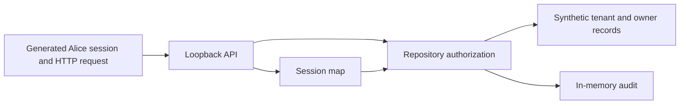

# Reproduce the multi-tenant authorization experiment

**Status: tested bounded HTTP target; production controls not tested.** See the
[research article](../index.md) for the per-operation matrix and residual risks.

## Objective and threat model

Compare the same seeded API under vulnerable and remediated data-access behavior.
Alice controls IDs, JSON and a tenant header; she cannot edit her server-side
session. Assets are synthetic customer/document/refund records. The trusted
session map supplies tenant/user/role; the API and agent wrapper must not replace
that context with client or object-owner authority. Manager may operate on owned
rows; reader may read/export owned rows and cannot update/delete/refund them.



## Prerequisites and isolation

Python 3.13+ **or** Docker with Compose; no package installation or credential is
required. Docker uses `network_mode: none`, an unprivileged user and a read-only
filesystem. No ports are published. Servers bind only to `127.0.0.1` at randomly
assigned ports even when run directly on a host. Reserve about 128 MiB and 15–20
seconds per full run. No cloud costs or persistent volumes exist.

## Setup and validation — tested

From the repository root, either command runs the entire real-HTTP experiment:

```sh
python3 vulnerability-research/api-bola-multi-tenant/lab/test_api.py
```

```sh
docker compose -p research-bola -f vulnerability-research/api-bola-multi-tenant/lab/compose.yaml config --quiet
docker compose -p research-bola -f vulnerability-research/api-bola-multi-tenant/lab/compose.yaml run --build --rm lab
```

`api.py` contains seed data, runtime-generated sessions, data access and both
configurations. `test_api.py` is the copy-and-run client: it creates the targets,
obtains generated sessions in-process, sends requests, asserts results and closes
the servers. The APIs have no unauthenticated session-bootstrap HTTP endpoint.

Expected: two test methods pass, with 14 paired cases / 28 HTTP matrix evaluations,
plus expiry, invalid-session, enumeration, role and header checks. The runner
returns nonzero if a secure denial changes state or an expected response differs.
No raw session material is printed. `Cookie: lab_session=<generated-at-runtime>`
is only a description of the authentication contract, not a credential to paste.

## Evidence and measurement

```sh
mkdir -p .artifacts/research
python3 vulnerability-research/api-bola-multi-tenant/lab/test_api.py > .artifacts/research/bola-http.txt 2>&1
python3 vulnerability-research/detection.py --test
```

Output lists case, mode, status and decision. State assertions establish returned
foreign titles, modified/deleted rows, exact export keys, refund count and absence
of secure side effects. Audit assertions check selected content/session sentinels.
The response-body equality check reduces content enumeration; timing is not measured.
Production false positives, TTD/TTC, browser security, refund idempotency, distributed
transactions and a real database are not measured or implemented by this lab.

## Teardown — tested

Each run closes both servers; `--rm` removes its container. For any interrupted run:

```sh
docker compose -p research-bola -f vulnerability-research/api-bola-multi-tenant/lab/compose.yaml down --volumes --remove-orphans
```

All data and sessions are in memory. Delete retained evidence after review.

## References

- [Study and primary-source context](../index.md)
- [Separate PostgreSQL row-policy integration lab](../../../labs/postgresql-rls/README.md)
