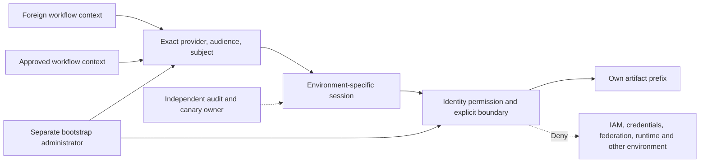

# CI/CD Workload Identity: Trust Binding, Permission Ceilings and Persistence


## Executive summary

**Observed, T1:** pinned-provider Terraform validates and produces separate staging
and production identities in mocked plans. **Observed, T3/T4 in a local model:**
exact subject/audience checks reject foreign contexts, and exported boundaries
reject modeled identity-management, cross-environment and runtime-modification
requests even with a broader identity grant.

**Not established:** any AWS STS exchange, AWS authorization decision or GitHub
hosted-workflow outcome. The [lab](lab/README.md) does not create cloud resources.
An authenticated approved workflow remains able to alter the artifacts its role
permits; federation does not remove that trust.

## Research question and hypothesis

Can an environment-bound workload identity publish only its own release artifacts
without acquiring role-management, credential-creation or cross-environment authority?

**Hypothesis:** exact OIDC trust plus a resource-scoped identity policy and explicit
deny boundary reject the declared escalation matrix. A modeled allowed management
operation, foreign subject admission or foreign artifact access refutes the local
hypothesis. Cloud enforcement is a separate future hypothesis requiring negative
STS/API calls in an authorized disposable account.

## Threat model

| Element | Scope |
| --- | --- |
| Assets | Role trust, permissions boundary, environment artifact prefixes, workflow/infrastructure integrity, independently retained audit evidence |
| Actor A | Workflow in another repository/branch/environment with an authentic issuer assertion |
| Actor B | Code execution in the approved workflow with all authority granted to its deployment session |
| Entry points | Federation audience/subject/provider, artifact APIs, IAM mutation APIs, runtime/repository update APIs |
| Trust boundaries | Issuer → exchange trust; role → permissions; staging → production; deployment → bootstrap administration; workload → log archive |
| Trusted/assumed | GitHub issuer, protected environment rules, bootstrap administrator, existing isolated bucket/OIDC provider and log owner |
| Tested impact | Local model admits or denies requests; no remote role or artifact is changed |



## Affected lab component and vulnerability class

The affected component is a deliberately weak **local trust/permissions model**:
provider-only admission and a wildcard identity policy. It is not a deployable
vulnerable AWS configuration; real AWS validates token signatures/claims and imposes
GitHub subject-policy requirements. The study concerns excessive federation trust,
privilege escalation and persistence opportunities from deployment authority.

The remediated documents come from [main.tf](lab/main.tf), exported by a verbose
mocked `terraform test` plan and consumed by [evaluate.py](lab/evaluate.py).
This avoids testing an unrelated hand-maintained JSON copy.

## Prerequisites, isolation and assumptions

Use Terraform 1.7+ (recorded run: 1.16.5), Python 3.13+ and the locked AWS 6.20.0
provider. Provider initialization downloads code; tests replace the provider with a
mock and use the all-zero synthetic account. No cloud credential is needed.
Do not run apply. Existing provider, bucket, resource policy, KMS, organization
controls and log archive are **assumptions**, not resources proven by this lab.

## Vulnerable implementation and controlled misuse paths

The vulnerable local model accepts matching provider identity without subject or
audience authorization and grants `Action: *`, `Resource: *`. That is a comparative
teaching condition, not a claim that an arbitrary self-edited token works at AWS.
The evaluator treats assertions and permissions as separate stages.

**Tested command**, from repository root:

```sh
bash vulnerability-research/cicd-identity-escalation/lab/validate.sh
```

| Precondition / controlled request | Vulnerable local result | Remediated local result and reason | Remaining surface |
| --- | --- | --- | --- |
| Authentic foreign repository or staging subject presented to production trust | Provider-only model allows | Exact subject rejects | Compromised approved repository remains trusted |
| Branch-form subject presented to environment-bound trust | Provider-only model allows | Environment subject required | Branch approval is an external GitHub protection rule |
| Wrong audience | Provider-only model allows | Exact `sts.amazonaws.com` rejects | Actual provider verification not executed |
| Different OIDC provider ARN | Denied | Denied | This case verifies the model's common baseline |
| `s3:PutObject` to own environment prefix | Allowed | Allowed | Malicious approved release content is still possible |
| `s3:PutObject` to other environment prefix | Allowed | Explicit boundary deny | Resource policies and other accounts not fully interpreted |
| `iam:CreateRole`, policy attach/put/version creation | Allowed | Explicit deny of every nonapproved API | Bootstrap administrator is a separate trusted identity |
| Boundary remove/replace; trust or federation creation | Allowed | Explicit deny | No claim of real IAM boundary-removal test |
| `iam:CreateAccessKey`, `iam:PassRole`, `sts:AssumeRole` | Allowed | Explicit deny | Other credentials accessible to approved code remain a separate risk |
| `lambda:UpdateFunctionCode`, `codecommit:GitPush`, `cloudtrail:StopLogging` | Allowed | Explicit deny | GitHub repository write authority is controlled outside AWS |
| Reuse identical locally signed assertion in staging trust | Not a cloud test | Rejected by subject mismatch | Same-context replay within lifetime remains accepted |

## Evidence and observed output

The recorded local run ends:

```text
PASS: 28 offline policy decisions; no STS calls
```

These consist of six trust cases, eighteen permission cases and four local signed
assertion/replay cases. The assertion format uses runtime-generated HMAC material;
it is **not a GitHub JWT/JWS verifier**. Expired and tampered assertions are rejected.
The same valid assertion is accepted twice in its authorized context. This is an
intentional residual finding: subject binding is not a single-use replay cache.

Each output record contains the case, stage, allow verdict and boundary verdict.
No token, HMAC key, session credential or production identifier is emitted. Terraform
also rejects wildcard subjects in a negative variable test. These are T1/T3/T4
local artifacts; they do not imply observed AWS API denials.

## Root-cause analysis

Federation trust answers **who may obtain the role**; permissions answer **what the
session may do**. Either can be broader than intended. A deployment session able
to edit roles, trust, boundaries, credentials, workflows or privileged runtime code
can potentially outlive its original purpose. Source-level code update authority
can itself be persistence authority even without IAM management.

The [AWS boundary documentation](https://docs.aws.amazon.com/IAM/latest/UserGuide/access_policies_boundaries.html)
distinguishes identity-policy intersections from direct role-session resource grants.
The lab therefore uses explicit denies for nonapproved APIs and S3 resources outside
the environment prefix. This is a narrow design, not a complete IAM interpreter.

## Remediation and verified-fix matrix

| Control | Artifact/tier | What still needs verification |
| --- | --- | --- |
| Dedicated environment roles | Terraform mock plan, T1 | Real role creation and exchange |
| Exact provider/audience/subject | Exported policy plus negative model cases, T3 | Actual issuer keys, token format and environment rules |
| Own-prefix GetObject/PutObject only | Permission model, T3/T4 | Bucket/KMS/SCP/resource-policy interactions |
| Boundary denies nonapproved APIs and foreign prefixes | Explicit-deny model, T3 | AWS authorization for session principals and service-specific conditions |
| Runtime cannot modify its boundary | IAM mutations denied in model | Independent bootstrap control and drift alert |
| Workflow requests short session | Illustrative workflow, T1 | Hosted runner and environment configuration |
| Audit independence | Declared output assumptions, T0 | Trail selectors, delivery, archive access and alerting |

AWS documents that `GetCallerIdentity` returns identity information even when an
explicit deny exists; it is not an escalation test. The illustrative workflow uses
that introspection operation only (T0, AWS API reference below).

The role is intentionally an **artifact deployment identity**, not an infrastructure
administrator. Do not enlarge its permissions to make this Terraform module apply
itself. Bootstrap and runtime identities have different responsibilities.

[GitHub's AWS guidance](https://docs.github.com/en/actions/how-tos/secure-your-work/security-harden-deployments/oidc-in-aws)
documents exact subject conditions and environment-specific subject forms. Inspect
the subject actually issued for the repository, including immutable-ID formats
where applicable; the example names are synthetic. Environment approval and branch
restrictions must be configured independently. The [workflow example](lab/verify-identity.workflow.yml)
is outside `.github/workflows` and performs only identity inspection.

## Business impact and severity reasoning

**Likely, conditional on actual excessive authority:** a compromised CI session
could alter deployment roles or future code paths. The local wildcard model
supports the permission precondition only; it does not establish an exploit against
AWS or a successful cloud persistence action. Severity depends on actual role,
resource policies, environment separation, reachable secrets and repository controls.
The lab's corrected artifact role still permits replacing own-prefix artifacts;
provenance and independent release approval are separate required boundaries.

## Detection engineering

The runnable [synthetic detector](../detection.py) distinguishes failed attempts
from reported-success IAM/runtime/logging changes attributed to a known lab
runtime role. Production attribution must derive role identity from trusted
CloudTrail session fields, not an input boolean. Audit event names such as
`UpdateAssumeRolePolicy` and `DeleteRolePermissionsBoundary` are candidate signals;
`iam:PassRole` is authorization evaluated during a destination service operation,
not a standalone event to search for.

An **illustrative, not executed** Sentinel query for a deployment-role inventory is
in [detection.kql](lab/detection.kql). Validate schema, event coverage, service
errors and session issuer before deployment. Capture STS exchange, downstream
resource access, IAM/policy mutation and workflow changes separately. S3 object
access requires selected data events; management-event coverage alone is insufficient.

## Containment runbook and compensating controls

1. Stop the affected release path and preserve workflow revision, artifact digests,
   triggering identity and relevant events before deleting evidence.
2. Restrict exact role trust to prevent new exchanges. Do not assume this revokes
   already issued sessions. Follow a separately reviewed provider session-revocation
   procedure and verify access loss against a disposable canary resource.
3. Inspect role/policy/boundary/federation/credential changes and runtime/repository
   modifications, including versions created during the exposure window.
4. Rotate downstream credentials actually exposed; restore reviewed trust and code
   from an independent administrator; verify allowed and denied operations again.
5. Re-enable releases only after environment governance, evidence collection and
   artifact verification have been independently checked.

Use protected environments, reviewed workflows, isolated runners, immutable action
pins, separate artifact promotion and a bootstrap administrator outside CI authority.
The runbook is **not executed** here. Time to contain is **not measured**.

## Limitations and what was not tested

No AWS account, GitHub hosted job, JWT discovery/signature path, STS exchange,
CloudTrail delivery, IAM simulator, credential revocation, real replay, bucket API,
production policy or cloud resource was tested. The local policy subset omits full
resource/session/SCP/RCP semantics, IAM case rules and service context. It refuses
unsupported statement keys rather than silently interpreting them.

Federation does not eliminate compromise of approved code, dependencies, protected
workflow maintainers or the bootstrap administrator. A stolen session retains its
allowed operations until provider lifetime/revocation controls actually stop it.
Pipeline duration impact, live detection coverage and operational cost are **not
measured in this lab**. Independent review remains required.

## Open questions

How quickly does trust removal affect new exchanges versus existing sessions?
Do direct session grants remain denied under the target resource policies? Can a
release signer independently reject an artifact written by a compromised approved
workflow? Which service update APIs create indirect persistence without IAM access?

## References

Consulted 2026-11-02. AWS/GitHub pages are living product documentation. Provider
schema is pinned to 6.20.0; Terraform mock support is versioned separately.

- [AWS role creation for OIDC federation](https://docs.aws.amazon.com/IAM/latest/UserGuide/id_roles_create_for-idp_oidc.html)
- [AWS permissions boundaries and session grants](https://docs.aws.amazon.com/IAM/latest/UserGuide/access_policies_boundaries.html)
- [GitHub OIDC in AWS](https://docs.github.com/en/actions/how-tos/secure-your-work/security-harden-deployments/oidc-in-aws)
- [AWS provider 6.20.0 IAM role source documentation](https://github.com/hashicorp/terraform-provider-aws/blob/v6.20.0/website/docs/r/iam_role.html.markdown)
- [Microsoft AWSCloudTrail table schema](https://learn.microsoft.com/en-us/azure/azure-monitor/reference/tables/awscloudtrail)
- [AWS PassRole and event semantics](https://docs.aws.amazon.com/IAM/latest/UserGuide/id_roles_use_passrole.html)
- [AWS GetCallerIdentity special permission behavior](https://docs.aws.amazon.com/STS/latest/APIReference/API_GetCallerIdentity.html)
- [Terraform provider mocking](https://developer.hashicorp.com/terraform/language/tests/mocking)
