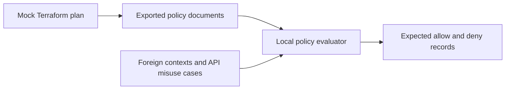

# Reproduce CI/CD identity policy decisions without cloud access

**Status: partially tested.** Terraform schema and mock plans plus a deliberately
limited local authorization model are tested. AWS STS, API enforcement, audit
collection and GitHub hosted execution are **not tested**. See the
[study](../index.md) for the exact evidence boundary and containment runbook.

## Objective, architecture and threat model

Compare a provider-only/wildcard local model with Terraform-exported exact trust,
resource scope and explicit deny controls. The actor controls a foreign workflow
context or compromises approved workflow code. Assets are synthetic environment
artifact prefixes and the ability to change future identities/code. Bootstrap
administration and audit ownership are separate trusted assumptions.



## Prerequisites and setup — tested

Terraform >=1.7,<2 (recorded 1.16.5), Python 3.13+, internet for the pinned AWS 6.20.0
provider download, and roughly 1 GiB free disk for provider binaries. No cloud
credential, account access, backend or environment variable is required.

From repository root:

```sh
bash vulnerability-research/cicd-identity-escalation/lab/validate.sh
```

The script initializes without a backend, checks formatting/schema, runs three
Terraform tests with `mock_provider "aws"`, exports the plan, and evaluates its
actual policy output. Expected final line:

```text
PASS: 28 offline policy decisions; no STS calls
```

Unsupported policy semantics cause a failure. The model handles only the statement
keys used by the exported documents; it is not the IAM simulator. Runtime-generated
HMAC assertions test local lifetime/tamper/replay decisions, not JWT verification.

## Terraform design and deployment assumptions

`main.tf` defines environment-specific deployment roles, exact audience/subject
trust, own-prefix artifact permission, and boundaries that explicitly deny every
other API and S3 resource. Input subjects must be the exact observed GitHub format;
readable and immutable-ID subjects cannot be substituted blindly.

A separately authorized cloud experiment would need an isolated account, an
existing reviewed GitHub provider, a private versioned artifact bucket, reviewed
KMS/resource/SCP policies, and an independent CloudTrail archive with management
and selected S3 data events. The runtime role cannot bootstrap its own infrastructure.
No provider or bucket is created by this module. No apply command is part of this lab.

The adjacent workflow is **illustrative** and inactive outside `.github/workflows`.
It requests a 900-second session only after protected-environment review and prints
caller identity, not credentials. Inspect action source and configure repository
variables before any separately authorized hosted experiment.

## Evidence collection and negative matrix

```sh
mkdir -p .artifacts/research
terraform -chdir=vulnerability-research/cicd-identity-escalation/lab test -json -verbose > .artifacts/research/cicd-plan.jsonl
python3 vulnerability-research/cicd-identity-escalation/lab/evaluate.py .artifacts/research/cicd-plan.jsonl > .artifacts/research/cicd-decisions.txt
python3 vulnerability-research/detection.py --test
```

Tests cover wrong provider/audience/repository/environment, branch-form subject,
foreign-prefix writes, identity/policy/boundary/federation/key creation and change,
PassRole, role chaining, runtime/repository updates, logging disablement, local
signed assertion tamper/expiry and replay. Same-context replay remains accepted.
The study maps each misuse to its precondition, result, fix and residual capability.

## Cleanup and cost

No cloud resources or real credentials exist. Mock plan tests do not leave managed
cloud state. Provider downloads remain under `.terraform/`; remove that directory
and retained `.artifacts/research/cicd-*` evidence after inspection. Keep the tracked
provider lockfile. A future authorized deployment would need separate bootstrap
state and a reviewed destroy plan for **only** its lab roles/policies. Never delete a
shared provider, bucket or trail as teardown. Cloud usage cost is not measured.

## References

- [Study and consulted primary sources](../index.md)
