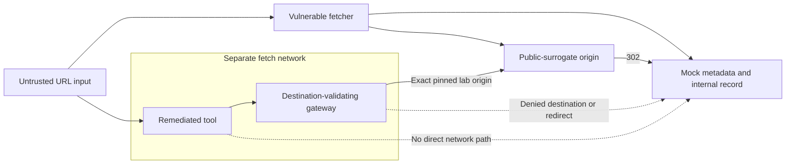

# MCP-style URL-fetch SSRF: Destination and Egress Boundaries


## Executive summary

**Observed, T4:** the vulnerable local fetcher returns a synthetic metadata marker
both directly and after a redirect. The remediated gateway denies those requests
and permits the intended public-surrogate origin. **Observed, T3:** the secure
container cannot open a direct TCP connection to the mock metadata fixture.
These claims concern [this lab](lab/README.md), not an MCP product vulnerability.

The tool is **MCP-style**: JSON input represents a model-influenced tool call.
It does not implement MCP transport, discovery, authorization or an LLM. The MCP
project's [security guidance](https://modelcontextprotocol.io/docs/2025-11-25/tutorials/security/security_best_practices)
discusses SSRF and token-passthrough risks; that sourced context is T0 here.

## Research question and hypothesis

Can a URL-fetch tool keep model-controlled destinations from acquiring the
server's internal-network authority while preserving a legitimate fetch?

**Hypothesis:** exact-origin selection, validation of every resolved address,
connection pinning, redirect denial and a separate egress boundary reject the
enumerated internal-fetch paths. One returned internal marker through the secure
path, or a successful direct secure-container connection to metadata, refutes it.

## Threat model

| Element | Scope |
| --- | --- |
| Assets | Synthetic internal record, synthetic metadata marker, gateway policy and decision logs |
| Actor | Local test caller controls the URL, path, query and redirect entry point |
| Entry point | `POST /fetch` with a single `url` field |
| Trust boundaries | Caller → tool; tool → gateway; gateway → resolved destination; redirect response → next hop |
| Trusted | Docker host, immutable lab code, pinned fixture address and gateway administrator |
| Impact tested | Retrieval of a marker across the intended boundary; no credential theft or code execution |
| Assumed in a real deployment | Tool host may have network access and credentials that the user lacks |



## Affected lab component and vulnerability class

[fetcher.py](lab/fetcher.py) deliberately contrasts `vulnerable_fetch` with
`FetchPolicy`. The insecure path uses the default redirect-following HTTP opener
without destination checks. The class is server-side request forgery: controlled
input selects a server-side request destination. Agent context can increase the
number of untrusted inputs reaching the tool and the authority of the tool host;
**this amplification is an inference, T0**, not a measured model outcome.

## Prerequisites and isolation requirements

Use Python 3.13+ for unit checks and Docker with Compose for topology checks. All
origins are repository-owned containers. No port is published; all three networks
are internal. Do not use a real metadata service. See the [complete setup](lab/README.md).

## Method and vulnerable implementation

The same six requests run against both modes. The “public” origin is private
Docker address `172.28.190.10`, explicitly pinned to `public.lab:8080` in the lab
adapter. This exception exists only to replace the internet with an isolated
fixture. It must not become a production private-address allowance.

The generic policy requires HTTPS on 443, a configured exact host, no userinfo or
fragment, and only global unicast DNS answers. It rejects mapped/transition address
forms, mixed public/private answers, and control-character/backslash ambiguity.
The connector uses the vetted numeric address; TLS uses the original hostname for
SNI and certificate validation. **That external TLS branch is not exercised over
an external connection**; pinning is tested with an injected transport.

## Controlled misuse paths and evidence

Run from the repository root; these are **tested commands**:

```sh
python3 vulnerability-research/mcp-tool-ssrf/lab/test_fetcher.py
docker compose -p research-ssrf -f vulnerability-research/mcp-tool-ssrf/lab/compose.yaml up -d --build vulnerable secure gateway public metadata
docker compose -p research-ssrf -f vulnerability-research/mcp-tool-ssrf/lab/compose.yaml run --rm tests
docker compose -p research-ssrf -f vulnerability-research/mcp-tool-ssrf/lab/compose.yaml exec -T secure python test_egress.py
```

| Precondition and request URL | Vulnerable observation | Fix and post-fix observation | Remaining surface |
| --- | --- | --- | --- |
| Caller can select `http://metadata.lab:8080/metadata` | 200, `SYNTHETIC_METADATA_NO_CREDENTIALS` | 403; HTTP is denied outside the exact surrogate origin | Real metadata protocols and host-level routes not tested |
| Caller can select `http://internal.lab:8080/internal` | 200, `SYNTHETIC_INTERNAL_RECORD` | 403; host/scheme policy prevents fetch | Compromised allowed service can still return sensitive data |
| Allowed origin returns 302 from `/redirect` | 200 with metadata marker | 403 `redirect_denied`; no redirect is followed | No multi-hop or status-code-specific redirect support is offered |
| Allowed origin returns >4 KiB at `/large` | 200 with truncated body | 403 `response_too_large` | Slow-response total deadline and streaming cancellation not implemented |
| Public surrogate `/metadata` (fixture-separation regression) | 400 upstream-not-found | 403 `upstream_status`; no marker returned | An allowed-origin compromise remains outside the fixture model |
| Intended origin `/` | 200 `PUBLIC_LAB_OK` | 200 `PUBLIC_LAB_OK` | Fixture success is not public-web availability evidence |

Sanitized observed HTTP body for the redirect denial:

```json
{"error":"redirect_denied"}
```

Sanitized observed gateway event (request ID omitted):

```json
{"event":"tool_fetch","mode":"gateway","decision":"deny","reason":"redirect_denied"}
```

The runner asserts the returned marker for the vulnerable metadata and redirect
cases and absence of a `body` on denied secure responses. It exits nonzero if any
status differs. The direct-network test prints:

```text
PASS: direct secure-container TCP path to mock metadata denied
```

## DNS bypasses, allowlists and egress considerations

**Observed, T3:** resolver fixtures reject a private-only answer and a mixed
public/loopback answer for an otherwise allowed HTTPS host. A changing-answer
fixture verifies that the transport receives the first vetted numeric address
without a second lookup. This is a deterministic TOCTOU regression test, **not an
observed DNS-server rebinding attack**. See `test_dns_pin_prevents_second_lookup`.

A hostname denylist alone leaves unlisted private ranges, alternate textual forms
and redirects to handle. An exact hostname allowlist alone does not establish the
IP reached. The [OWASP prevention guidance](https://cheatsheetseries.owasp.org/cheatsheets/Server_Side_Request_Forgery_Prevention_Cheat_Sheet.html)
informs the layered design (T0). This implementation selects a deliberately small
input language instead of accepting every URL syntax.

The secure tool lacks a route to the target network; only the gateway joins it.
The gateway also has no internet route. This topology tests a controlled proxy
boundary, not a production firewall, VPC endpoint, service mesh or CNI. Docker-host
compromise and an allowed-origin compromise remain outside the hypothesis.

## Root-cause analysis and impact

The insecure tool turns a user-controlled string into a network action under the
server's authority. Redirect following delegates destination selection to a second
untrusted party. Schema-valid JSON and a valid user session would not authorize an
internal destination. The secure path resolves authorization before connection and
keeps redirects from introducing a new destination.

**Severity reasoning:** material confidentiality impact in the synthetic service,
because a caller retrieves an explicitly internal marker. A real severity depends
on reachable assets, metadata protocol requirements and the tool's permissions.
Credential exposure is **not established**: the mock deliberately contains no
credential, and no real cloud endpoint is contacted. No system compromise is claimed.

## Remediation and verified-fix matrix

| Control | Tier and artifact | Verification limit |
| --- | --- | --- |
| Scheme, port, userinfo and exact-host restrictions | T3 unit negative corpus | Restrictive parser contract, not exhaustive URL fuzzing |
| Private, loopback, link-local, shared and metadata-address denial | T3 address classifier plus DNS corpus | Some cases are pure function checks; no packets sent |
| Resolve all answers and bind connection | T3 injected resolver/transport | External TLS branch not network-tested |
| Redirect denial and response cap | T4 paired HTTP tests | Redirects are unsupported, not selectively permitted |
| Tool cannot directly reach metadata | T3 actual Docker TCP attempt | Host and gateway are trusted |
| Scoped short-lived credentials | Not applicable to this fixture | No downstream credential exists; real adapters must acquire resource-specific credentials and avoid forwarding caller tokens |
| Structured audit logging | T2 emitted events | No durable collector or SIEM integration tested |

## Regression tests and detection engineering

Unit cases cover address classes, parser restrictions, empty allowlists, DNS-empty,
mixed-answer and pin-mismatch failure. The Compose runner supplies the six paired
HTTP cases. [Detection predicates](../detection.py) are executable:

```sh
python3 vulnerability-research/detection.py --test
```

A denied fetch is a **blocked-attempt signal**, not proof of malicious intent.
Deduplicate tool/gateway events using a propagated correlation ID in a real
integration; this lab generates separate IDs. Monitor gateway health and expected
canary delivery independently of denials. Never interpret zero events as zero SSRF.
A future SIEM integration should alert on denied destinations/redirects and unusual
fetch frequency, while retaining reason codes rather than query/body data.

## Compensating controls, operations and residual capability

Separate the gateway's administration, deny arbitrary tool egress, remove ambient
cloud roles, and cap body size and request duration. Use a dedicated read-only
content service when arbitrary URLs are unnecessary. Fail closed on DNS/gateway
errors; do not restore availability by granting a general proxy path. Log minimal
metadata and impose retention/access controls. An attacker may still fetch permitted
content, consume bounded resources, or exploit a defect in an allowed destination.

## Limitations and what was not tested

No LLM, real MCP server/client, OAuth exchange, real credentials, external HTTPS,
DNS server rebinding, IPv6 Docker routing, host firewall, cloud metadata protocol,
service-mesh bypass, compression bomb or production rate/load test was executed.
Socket timeouts are per operation, not a proven total request deadline. Availability,
time to detect/contain and monthly operational cost are **not measured in this lab**.
Review status remains `requires-review` pending an independent evidence review.

## Open questions

Can the external TLS branch retain pinning across certificate rotation and IPv6?
What total deadline prevents a slow-byte origin from monopolizing workers? Does a
production gateway prevent alternate resolver/proxy routes? Can correlation survive
a gateway failure without recording destination content?

## References

Consulted 2026-11-02; the OWASP and MCP pages are living guidance, not new CVE advisories.

- [OWASP SSRF Prevention Cheat Sheet](https://cheatsheetseries.owasp.org/cheatsheets/Server_Side_Request_Forgery_Prevention_Cheat_Sheet.html)
- [MCP security best practices under 2025-11-25 documentation](https://modelcontextprotocol.io/docs/2025-11-25/tutorials/security/security_best_practices)
- [Python 3.13 ipaddress semantics](https://docs.python.org/3.13/library/ipaddress.html)
