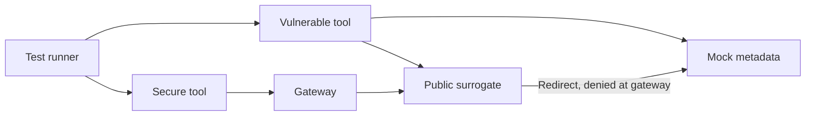

# Reproduce the URL-fetch SSRF experiment

**Status: partially tested.** Real isolated HTTP and TCP paths are tested; DNS and
external TLS connection selection use injected fixtures. Read the
[study](../index.md) for threat model, findings and untested bypass surfaces.

## Objective, architecture and safety

Compare an ambient fetcher to a tool whose only destination-capable path is a
separate gateway. Assets are synthetic markers, not credentials. A caller controls
URLs and redirects. The secure tool trusts the gateway/Docker host and has no
network attachment to the metadata fixture.



Prerequisites: Docker Engine, Compose, Python 3.13+ for optional host unit checks,
and about 256 MiB of memory. Image builds download a pinned Python patch image;
application code has no third-party dependencies. All networks are internal; no
ports, host paths, Docker socket, cloud identities or production data are exposed.
Subnet `172.28.190.0/24` must be free. If it conflicts, change both Compose fixed
addresses and `LAB_PUBLIC_IP`/`test_egress.py` together.

## Setup and validation — tested

From the repository root:

```sh
python3 vulnerability-research/mcp-tool-ssrf/lab/test_fetcher.py
docker compose -p research-ssrf -f vulnerability-research/mcp-tool-ssrf/lab/compose.yaml config --quiet
docker compose -p research-ssrf -f vulnerability-research/mcp-tool-ssrf/lab/compose.yaml up -d --build vulnerable secure gateway public metadata
docker compose -p research-ssrf -f vulnerability-research/mcp-tool-ssrf/lab/compose.yaml run --rm tests
docker compose -p research-ssrf -f vulnerability-research/mcp-tool-ssrf/lab/compose.yaml exec -T secure python test_egress.py
```

Expected: six unit test methods pass; six paired HTTP cases pass; direct TCP
bypass is denied. All harnesses fail nonzero on unexpected decisions. Run the HTTP
cases before the TCP test so a stopped metadata fixture cannot be mistaken for
network isolation. The image entrypoint listens only inside its private networks.

`compose.yaml` supplies both configurations in one isolated experiment. Their code
paths live in `fetcher.py`; `fixtures.py` supplies the origins. Do not deploy either
teaching server as a public proxy. The default generic policy has an empty
allowlist; only the explicit synthetic origin is permitted in Compose.

## Collect evidence

```sh
mkdir -p .artifacts/research
docker compose -p research-ssrf -f vulnerability-research/mcp-tool-ssrf/lab/compose.yaml run --rm tests > .artifacts/research/ssrf-http.txt
docker compose -p research-ssrf -f vulnerability-research/mcp-tool-ssrf/lab/compose.yaml logs --no-log-prefix secure gateway > .artifacts/research/ssrf-decisions.jsonl
python3 vulnerability-research/detection.py < .artifacts/research/ssrf-decisions.jsonl
```

Review raw evidence before sharing. Events intentionally omit URLs, queries,
headers and fetched bodies. Request IDs are local, not a durable cross-service
trace. TTD/TTC, public TLS, real DNS rebinding and cloud metadata remain untested.
No cloud cost is incurred; local image/disk/CPU use is the resource cost.

## Teardown — tested

```sh
docker compose -p research-ssrf -f vulnerability-research/mcp-tool-ssrf/lab/compose.yaml down --volumes --remove-orphans
```

Remove retained `.artifacts/research/ssrf-*` files after reviewing your evidence.
Images/build cache remain local and can be removed through Docker's image manager.

## References

- [Study, claim ledger and consulted primary sources](../index.md)
